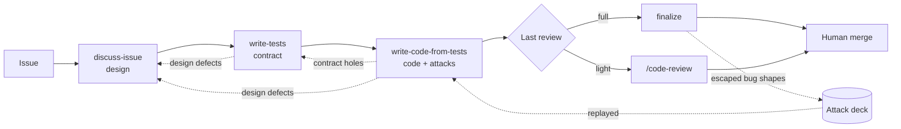
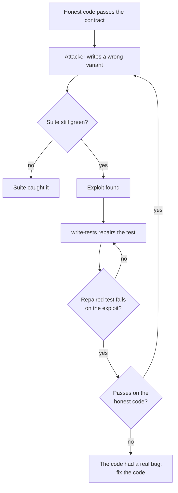
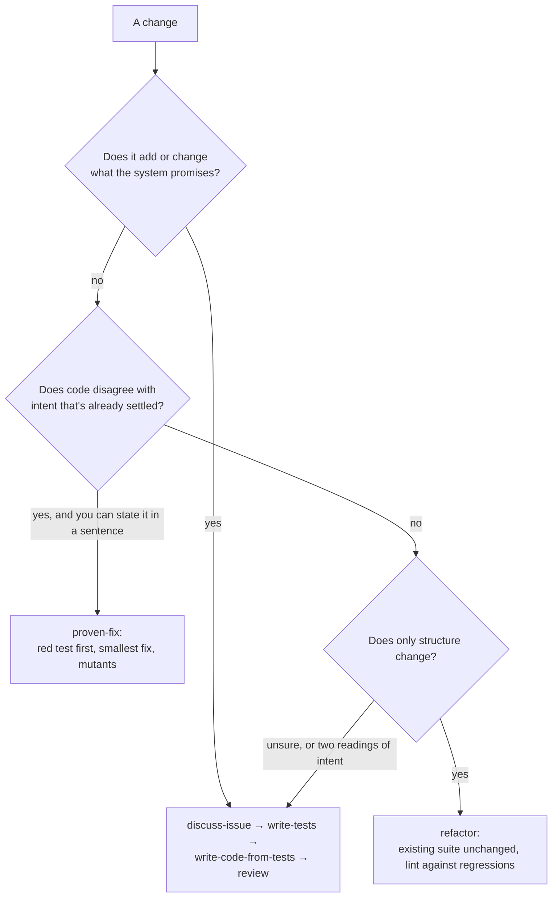

# How contract-first works, and why

This is the design behind the plugin: where it comes from, what each stage is for, the reasoning, and where it falls short.
The [README](../README.md) covers install and use; the skills hold the working instructions.

## Not a new idea

Writing the tests first and treating them as the agreement between intent and code is old practice.
The plugin borrows from:

- **Test-driven development**: tests written before the code they check.
- **Acceptance-test-driven development, BDD and specification by example**: concrete, executable
  examples agreed up front stand in for a written specification.
- **Mutation testing**: deliberately wrong versions of the code check whether the tests notice. The
  attackers here are hand-written, intent-aware mutants.
- **Extreme Programming's spike**: throwaway code written to learn, not to keep.

The name overlaps with two unrelated ideas: Bertrand Meyer's _design by contract_ (pre- and
post-conditions inside the code) and _contract-first APIs_ (writing the OpenAPI schema before the
service). Neither is what this plugin does.

What's specific here is that the authors, implementers and reviewers are agents. Left to itself, an
agent decides what an issue means, writes code to that reading, then writes tests that pass on that
code, so nothing ever disagrees. The plugin puts disagreement back: a human settles the intent,
tests pin it before code exists, and each later stage is set up to doubt the one before.

## Why a design and tests, and no independent spec

Two artifacts carry the intent, and each holds what the other can't:

- **The design** holds the why: scope and non-goals, data models and types, flows, the architecture chosen and
  the trade-offs behind it. Tests can't express a rationale or a deliberate omission.
- **The tests** hold the what, in a form that can fail. A sentence in a document can't stop wrong
  code from shipping. The tests are the spec.

A written spec in between isn't needed. A natural-language spec exists so that people can
coordinate on detail too fine for the design and too early for code. Agents don't need that layer:
given the intent, they can turn it straight into tests, and the tests then serve as the spec,
exact where prose would leave room for two readings. The design can stay compact and lean on
shared context. That cuts both ways: whatever it leaves implicit still has to be settled, and here
that happens when the tests are written and reviewed, not in more prose. This is a judgment from running the
pipeline without a spec, not a measured comparison.

The tests are committed **alone, before any implementation**, as a fixed reference. That makes the
order provable from git history rather than from an agent's account, and it stops the code stage
from quietly bending a test to fit what it wrote. When code and tests disagree, that's a finding to
route, never a licence to edit the test.

## The pipeline

| Stage                      | Produces                                                                                      | The human decides                                 |
| -------------------------- | --------------------------------------------------------------------------------------------- | ------------------------------------------------- |
| discuss-issue              | A design: behavior, scope, data models, flows, architecture, with probed facts and a code map | What to promise, and the consequential trade-offs |
| write-tests                | A committed test contract and a map of which test enforces which promise                      | Only design amendments the tests expose           |
| write-code-from-tests      | Code that passes the contract, attacked by wrong variants; a PR                               | Only design amendments the code exposes           |
| finalize or `/code-review` | A reviewed, re-greened PR; follow-up issues; new attack-deck entries                          | Whether to merge                                  |

## Sketch and spike: finding the better way before it's expensive

A familiar moment: halfway through building something one way, you see how it should have
been built. Usually that moment arrives after the expensive work is done, and then you either
rewrite or live with the first way.

write-tests arranges for that moment to come early and cheap. A thin **sketch** writes one test per
important promise, which forces each design choice into concrete setup and expected results, where
gaps show. A **spike** then implements the core flows for real, against the sketch, and logs every
guess, workaround and place where the design fought the existing code. The spike's code is thrown
away and never shown to later workers; only what it learned travels. A fresh reader checks the
design against both, and the design is corrected before the thorough tests are written, while
changing course costs a few files instead of a suite.

## Reading for fidelity, running for discrimination

A contract can fail in two ways, and each needs a different check:

- **Fidelity:** does the suite demand the right behavior, nothing invented and nothing narrowed?
  That's a question about meaning, so a fresh reviewer _reads_ it, without the author's reasoning.
- **Discrimination:** does the suite reject wrong code? Reading can't answer that. Suites that
  readers had cleared still passed five to nineteen deliberately wrong implementations.

Discrimination is tested by running. Once the honest implementation passes, two or three
attackers, each focused on one risk area, try to keep the suite green with wrong variants of that
code. Starting from working code is cheaper than each attacker building its own, and each exploit
becomes a patch that the repaired test must be shown to catch.

## Where findings go

Every stage can find a problem that belongs to an earlier one. Findings are grouped by cause first,
since one model or flow change often dissolves several, then routed by kind:

| Finding                                                      | Goes to                                                                                 |
| ------------------------------------------------------------ | --------------------------------------------------------------------------------------- |
| A factual question                                           | A probe. The human doesn't decide what existing code does                               |
| Code is wrong under the settled design                       | Fixed in the code stage                                                                 |
| A test omits, misstates or fails to enforce settled behavior | write-tests' repair author                                                              |
| The design is wrong or leaves a consequential choice open    | discuss-issue's amendment, put to the human as "this is a bug; here are the trade-offs" |

Human attention goes to consequential design choices, never to one question per edge case.

## Why each stage starts cold

Every stage runs as a fresh session that never saw the previous one. GitHub is the only channel:
the issue, its comments, the branch and the PR. That makes any stage resumable after a crash,
inspectable by a person, and runnable headless as one command per stage.

## Why finalize reads cold

write-tests writes its hand-off note for the implementer, and the implementer reads it. finalize
deliberately doesn't. A reviewer who has read the argument for each choice tends to agree with it,
because the argument is right there. finalize reads the code, the diff and the tests. It does read
the earlier _review_ trail, but checks who wrote each comment, since on a public repo anyone can
comment and finalize holds a push credential.

## Two nets for what escapes

When a bug ships green, finalize traces it back, through a subagent that reads the records it
skipped, to the stage where the defense should have held. The result goes to one of two places:

- **The attack deck** gets the exploit's _shape_, when the design stated the intent and the suite
  passed anyway. Attackers replay the deck on every future contract.
- **The human** gets process findings: which stage missed, and what rule or check might stop it.
  One PR is one data point, so the human weighs it against others before changing the pipeline.

A deck entry that restates a test-writing rule, or a process finding that's really "replay this
exploit", makes the two nets miss the same things, so they stay separate. The deck belongs to each
project, at `.claude/contract-first-attacks.md`; the plugin defines only its format.

## Choosing a lane

The full pipeline is for new or changed promises. Most changes don't need it, and you pick the lane;
skills don't route themselves.

The lighter lanes hand back rather than decide: they have nowhere to record a design decision.

## Limitations

- **Tests pin only what someone thought to assert.** Intent the design never stated is never
  enforced, and the attackers deliberately attack only stated intent. A green suite is evidence
  about its assertions, not proof of correct code.
- **Attacks sample; they don't prove.** An attacker that finds nothing has missed its samples, not
  shown the suite is tight.
- **The checkers share blind spots.** Authors, reviewers and attackers are usually the same family of
  model. Reading cold removes shared context, not shared habits of thought, so they can all miss the
  same kind of bug. The attack deck and the human at the merge are the main counterweights.
- **Some properties don't fit in tests.** Performance, usability, the quality of prose or prompts,
  and security beyond the cases someone enumerated get little from this pipeline.
- **The design is the ceiling.** A wrong design gets faithfully enforced. The pipeline asks the human
  for consequential choices; it can't make them well on the human's behalf.
- **It costs a lot.** A full run dispatches many agents and takes hours of wall time. That's why the
  lighter lanes exist, and choosing the lane is on you.
- **It's only as good as the test harness.** Without real seams to inject fakes and observe effects,
  tests check less than they appear to.
- **Tests-first history is pinned.** The contract commit must precede the code, so the branch can't
  be freely rebased; long-lived branches get awkward.
- **It's tuned on one project.** The skills and the numbers in this document come from running it
  on one Python codebase. Expect to adjust them elsewhere.

## Keeping agent work cheap

Most of the cost is agents re-reading what they already read, so the skills spend on fewer steps
with smaller histories. Facts about the code are gathered once into a shared code map; each worker
still works out on its own what must hold. Workers outline a file before reading it and read only
the parts they need. Every dispatch names its model and effort: Opus where judgment carries the
result (design check, fidelity review), Sonnet where the design is settled and the work is
expanding it (thorough authoring, spikes, attackers).
