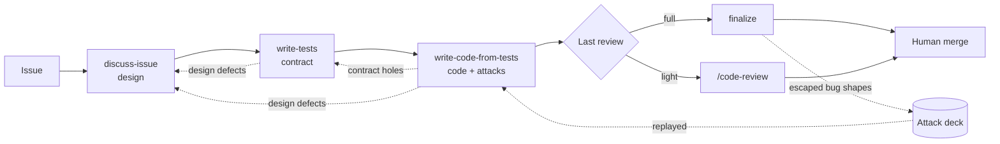
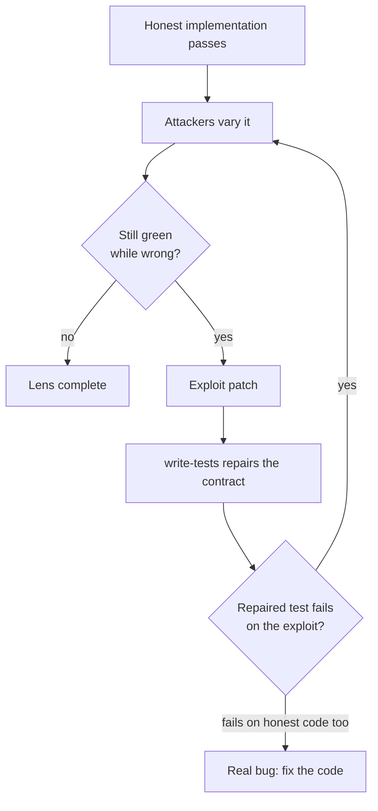
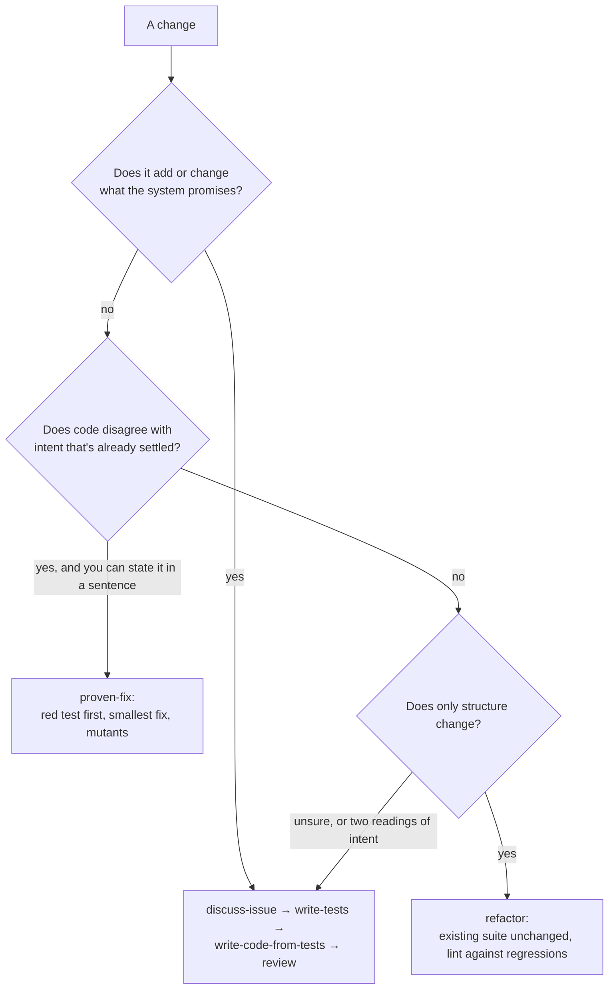

# How contract-first works, and why

This is the design behind the plugin: what each stage is for, and the reasons for the choices that
look odd at first. The [README](../README.md) covers install and use; the skills themselves hold the
working instructions.

## The problem it solves

An agent asked to "implement this issue" decides what the feature means and writes the code that
meets its own reading, then writes tests that pass on that code. Every step agrees with the step
before it, so nothing ever disagrees. Bugs ship green, and the design decisions that caused them
were made quietly at the keyboard, where no human saw them.

contract-first separates those moments. The human settles what the system should promise. Tests
written *before* any code pin that promise. The code is then built to the tests, and attacked to
find what the tests let through. Each stage is set up to disagree with the one before it.

## The pipeline

| Stage | Produces | The human decides |
|---|---|---|
| discuss-issue | A design: behavior, scope, data models, flows, architecture, with probed facts and a code map | What to promise, and the consequential trade-offs |
| write-tests | A committed test contract and a record of which test enforces which promise | Only design amendments the tests expose |
| write-code-from-tests | Code that passes the contract, attacked by wrong variants; a PR | Only design amendments the code exposes |
| finalize or `/code-review` | A reviewed, re-greened PR; follow-up issues; new attack-deck entries | Whether to merge |

## Why tests are the contract

There is no separate spec document. The design says what should happen and why, and the tests
enforce its observable commitments. A spec in between would be one more artifact to keep in sync,
and the one thing that actually stops wrong code from shipping is a test that fails.

The tests are committed **alone, before any implementation**, as a fixed reference. That makes the
order provable from git history rather than from an agent's account, and it means the code stage
can't quietly bend a test to fit what it wrote. When code and tests disagree, that's a finding to
route, never a licence to edit the test.

A green suite is still only evidence about what its assertions check. The rest of the pipeline is
about making that evidence worth trusting.

## Why the design is settled before the tests are thorough

Writing concrete cases is how design holes surface, so write-tests starts with a thin **sketch**:
one case per important promise. Writing code surfaces a different kind of hole, where the design
doesn't fit the system it lands in, so a throwaway **spike** implements the core flows and logs
every guess and workaround. Its code is never kept. A fresh reader then checks the design against
both before the expensive, thorough pass begins.

The order follows where problems are cheapest to fix: a design change after thorough tests are
written means rewriting them.

## Reading for fidelity, running for discrimination

A contract can fail in two ways, and each needs a different check:

- **Fidelity:** does the suite demand the right behavior, nothing invented and nothing narrowed?
  That's a question about meaning, so a reviewer *reads* it, without seeing the author's reasoning.
- **Discrimination:** does the suite reject wrong code? Reading can't answer that. Suites that
  readers had cleared still passed five to nineteen deliberately wrong implementations.

So discrimination is tested by running. Once the honest implementation passes, two or three
attackers, each with a risk area to focus on, try to keep the suite green with wrong variants of
that code. Starting from working code is cheaper than each attacker building its own, and every
exploit becomes a patch that a repaired test must fail against.

## Where findings go

Every stage can find a problem that belongs to an earlier one. Findings are grouped by cause first,
since one model or flow change often dissolves several, then routed by kind:

| Finding | Goes to |
|---|---|
| A factual question | A probe. The human doesn't decide what existing code does |
| Code is wrong under the settled design | Fixed in the code stage |
| A test omits, misstates or fails to enforce settled behavior | write-tests' repair author |
| The design is wrong or leaves a consequential choice open | discuss-issue's amendment, put to the human as "this is a bug; here are the trade-offs" |

Human attention goes only to consequential design choices, never to one question per edge case.

## Why each stage starts cold

Every stage runs as a fresh session that never saw the previous one. GitHub is the only channel:
the issue, its comments, the branch and the PR. That makes any stage resumable after a crash,
inspectable by a person, and runnable headless as one command per stage. It's also why write-tests
ends by posting a hand-off note.

## Why finalize reads cold

write-tests writes its hand-off note for the implementer, and the implementer reads it. finalize
deliberately doesn't. A reviewer who has read the argument for each choice tends to agree with it,
because the argument is right there. finalize's value is being the one reader who hasn't been told
what to think: it reads the code, the diff and the tests. It does read the earlier *review* trail,
but checks who wrote each comment, since on a public repo anyone can comment and finalize holds a
push credential.

## Two nets for what escapes

When a bug ships green, finalize traces it back, through a subagent that reads the records it
skipped, to the stage where the defense should have held. The result goes to one of two places,
on purpose:

- **The attack deck** gets the exploit's *shape*, when the design stated the intent and the suite
  passed anyway. Attackers replay the deck on every future contract. It's mechanical and automatic.
- **The human** gets process findings in finalize's report: which stage missed, and what rule or
  check might stop it. One PR is one data point, so the human weighs it against others before
  changing the pipeline. finalize never edits the skills itself.

Keeping them apart matters: a deck entry that restates a test-writing rule, or a process finding
that's really "replay this exploit", makes the two nets miss the same things.

The deck belongs to each project, at `.claude/contract-first-attacks.md`, because it records that
project's bugs. The plugin defines only its format.

## Choosing a lane

The full pipeline is for new or changed promises. Most changes don't need it, and you pick the lane;
skills don't route themselves.

The lighter lanes hand back rather than decide: they have nowhere to record a design decision.

## Keeping agent work cheap

Most of the cost is agents re-reading what they already read, so the skills spend on fewer steps
with smaller histories. Facts about the code are gathered once into a shared code map; each worker
still works out on its own what must hold. Workers outline a file before reading it and read only
the parts they need. Every dispatch names its model and effort: Opus where judgment carries the
result (design check, fidelity review), Sonnet where the design is settled and the work is
expanding it (thorough authoring, spikes, attackers).
