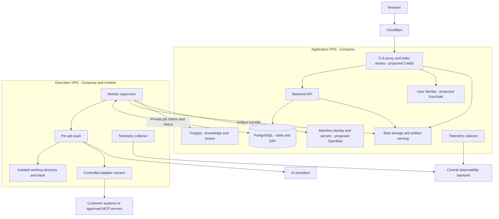

# VPS deployment, service architecture, and identity

A low-cost deployment for the complete application: a static frontend, API,
authentication, investigation and learning workers, knowledge publication, and
artifact serving. Application services and execution workers run on **different
VPS hosts**, each managed with Docker Compose.

## Decisions and scope

The selected direction is:

- Self-host with Compose; no Kubernetes initially. Accept downtime and loss of
  experimental data rather than buying high availability in advance.
- Separate the application host from the execution host and its runtime privileges.
- Serve static frontend assets behind Cloudflare and a TLS reverse proxy.
- Authenticate API requests with signed JWT access tokens carrying tenant context;
  accept bounded authorization staleness and keep request authentication stateless.
- Use PostgreSQL for application state, audit, and transactional job coordination.
- Confine brains and output processors separately from the privileged launcher.
- Serve generated HTML on tenant-specific artifact origins with sandbox restrictions.
- Use Tailscale SSH for administrative access.
- Collect application and operational telemetry centrally, separately from audit
  records and run evidence.
- Preserve the brain/hands split, with system access through controlled adapters.
  The execution isolation implementation remains selectable, including microVMs.

Keycloak, OpenBao, a Caddy proxy, and the initial blob-storage backend
are service recommendations. PostgreSQL is selected for application state and jobs.
**Moving findings and curation workflow state to
PostgreSQL is a proposal for further decision**, described below. This document
sets architectural direction; it does not claim that production integrations or
that migration are implemented.

## Principles

Inherit the [engineering principles](../../../docs/principles.md),
[threat model](threat-model.md), and
[credential-free executor model](runtime-isolation-executor-model.md).

Model output and writable run files are untrusted. Arbitrary model-written code
runs only in an executor; trusted orchestration and adapters hold the credentials
needed for their specific work. Separate logical roles do not imply a security
boundary unless their credentials, processes, network access, and filesystem
access are actually restricted.

Keep one authoritative owner for each kind of state. Git review governs published
knowledge; databases coordinate mutable workflow; artifact storage holds large
run outputs. Keep infrastructure reproducible, resource use bounded, and failures
visible. Budget constraints do not weaken tenant authorization or isolation.

## Intent

- **V1 — Complete deployment:** start the frontend, identity, API, storage,
  knowledge service, and workers through reproducible host configurations.
- **V2 — Tenant authorization:** derive request tenant authority from verified,
  issuer-controlled claims. Scope resource operations to that tenant. Machine
  authority is independently limited by tenant, job, and purpose.
- **V3 — Executor isolation:** confine model-written code to approved filesystems
  and resources without credentials, administration sockets, or network access.
  Select the isolation backend explicitly; an unavailable backend refuses visibly.
- **V4 — Execution ownership:** job claims, cancellation, completion, and cleanup
  have trusted owners. An expired lease alone cannot authorize an overlapping run.
- **V5 — Economical operation:** support a small application host and a separately
  stoppable execution host without requiring Redis or a cluster orchestrator.
- **V6 — Safe presentation:** show model-controlled transcripts as data in the app;
  isolate independently generated HTML from the application's browser authority.
- **V7 — Operational visibility:** correlate requests, jobs, tools, and host activity
  while protecting customer payloads and credentials from general telemetry.

There is no initial availability or throughput guarantee. Neither host has been
selected or sized. Separate hosts do not provide high availability or protect
against compromise of every trusted worker capability.

## Design

### 1. Hosts and services

The browser is an external client. Cloudflare is the public edge; only intended
web routes reach the application host. Private service traffic and administrative
access use restricted encrypted connections.



| Component | Responsibility |
| --- | --- |
| Proxy, proposed Caddy | TLS, static assets, explicit public routes and request limits. |
| Backend API | JWT validation, tenant-scoped records and audit, job submission/status, artifact grants. No runtime administration. |
| Keycloak, proposed | Product OIDC issuer, external OIDC/SAML identity brokering, controlled membership/invites. Separate from lab identity services. |
| PostgreSQL | Application records, audit, and durable job coordination. Proposed findings workflow owner. Keycloak uses a separate database/user on the same server if colocated. |
| Blob service | Run/episode bundles, transcripts, reports, HTML and assets; private storage with authorized artifact delivery. |
| Forgejo | Git storage plus access control, branches, pull requests, review, and protected publication. Its own local SQLite database can remain. |
| OpenBao, proposed | Workload authentication, tenant/purpose credential issuance and secrets. |
| Worker supervisor | Admission, job claims, brain/executor lifecycle, artifact publication and terminal status. |
| Brain | LLM loop, provider client, and typed tool dispatch. |
| Adapter runner | Approved CLI wrappers or MCP clients with limited system access. A logical role, not necessarily a standalone network service. |

Compose manages each host's long-lived services. It provides no cross-host
scheduler or service network. Use stable private service addresses, authenticated
connections, and explicit network policy. Database roles, issuer policies, and
artifact grants constrain worker access; private networking alone is insufficient.
The worker can access neither the application host's Docker daemon nor Keycloak's
database. Worker credentials do not authorize host administration.

### 2. Human identity and stateless API authentication

The static frontend uses OIDC Authorization Code with PKCE, a public client, and
exact redirect URLs. Keycloak is the proposed application issuer and can broker
external identity providers; Google is one example, not a product constraint.
[Keycloak supports external OIDC/SAML identity brokering](https://www.keycloak.org/docs/latest/server_admin/index.html#_identity_broker).
External login establishes a person, not tenant membership. Membership must be
controlled by trusted enrollment/invite administration, with one authoritative
owner feeding issuer claims. Do not link accounts solely by matching email.

The browser holds access and refresh tokens in memory and sends access tokens in
the Authorization header. It does not persist them in localStorage or
sessionStorage. Refresh/reload can use the IdP session, subject to browser limits.
This follows the [Keycloak browser adapter guidance](https://www.keycloak.org/securing-apps/javascript-adapter).
The API validates allowed algorithm, signature/JWKS, issuer, API audience, and
validity times. It derives principal and tenant from verified claims, never from
an untrusted tenant selector. Resource queries and writes enforce that tenant.

Ordinary request authentication has no per-user application session lookup or
membership lookup. Application data and the IdP's own sessions remain stateful.
A proposed five-minute access-token lifetime bounds stale membership authority;
refresh issuance must reevaluate current membership. Logout or disabling refresh
does not retroactively invalidate an already issued access token. The accepted
trade-off also covers ordinary sensitive operations unless a future policy adds
fresh authorization or step-up checks; do not silently promise immediate revocation.

This is direct SPA-to-API bearer authentication. A backend-for-frontend (BFF)
would instead keep OAuth tokens server-side and give the browser an opaque
HttpOnly session cookie. That is the cookie-based alternative discussed, not the
selected request-authentication design. JWT format alone does not determine
browser storage or session architecture.

Keep Keycloak administration private: its admin routes share its application
listener, so restricting only the management port is insufficient. Configure
Cloudflare/proxy trust explicitly and prevent bypass through direct origin access.

### 3. Brain, executor, and system access

The brain runs trusted product code, calls the AI provider, and dispatches a
fixed tool surface. Model-selected shell commands go into the assigned executor,
never into the brain or adapter host process. Provider credentials and network
access remain outside the executor. A compromised brain can still expose its own
credentials; the typed tool table limits normal model influence, not brain RCE.

The executor provides the working directory and bash/file tools. Approve its
mounts, environment, CPU, memory, PID and disk budgets; exclude credentials,
runtime sockets, and network access. gVisor and microVMs are possible backends.
A microVM backend needs an appropriate host and filesystem/control mechanism;
Docker bind mounts are a description of today's backend, not a universal contract.

Adapters expose typed operations over an accepted tenant and configured system.
Trusted code chooses endpoint, identity, executable, and permitted operations.
A CLI wrapper controls argv, config, environment, and working directory: avoiding
shell interpretation alone does not disable hooks, plugins, configuration-based
execution, or credential redirection. MCP clients connect only to approved
servers. Local MCP servers are executable software with an explicit trust level.

A trusted adapter module can initially share the brain process. Separate runners
are useful when limiting credentials, network paths, or crash impact. Learning
must receive only the integrations its workload needs: a learning job that needs
estate/oracle access is different from a curator that needs only artifacts and
knowledge. Sharing code or an image must not imply sharing all permissions.

The supervisor owns execution-host runtime privileges. Restrict brain-to-launcher
operations to the job's assigned executor and approved configuration. The brain
and executor should not receive a general Docker socket. This launcher privilege
split requires integration work beyond the existing bash isolation library.

Run each brain in an OS-confined job process/container, with its assigned files,
provider access, and approved adapter capabilities, without launcher privileges
or other jobs' secrets. This limits blast radius; it does not protect credentials
or network authority supplied to that brain from a compromise of the brain.

Parse and render run outputs in a separate restricted process/container. Give it
only the assigned input and output locations, no credentials or runtime socket,
and no network. The supervisor coordinates this work rather than loading complex
artifact parsers or rendering plugins into its privileged process. Keep its IPC
small, bounded, and validated. A narrow uploader receives only the required
artifact-store authority and validates paths and destination scope; sandboxing a
renderer does not make its outputs trustworthy. These are permission profiles,
not a requirement for separate always-on network services.

Trusted readers, adapters, and artifact uploaders treat executor-written files,
paths, and links as hostile. Preserve existing startup identity checks,
link-refusing reads, mount discipline, and distinct investigation versus learning
close/draft semantics.

### 4. Jobs and cross-host lifecycle

Use one worker codebase/image with fixed investigation and learning handlers.
Permission profiles and process/container placement remain explicit; a single
all-privileged worker pool is not required. Initially propose one active outer
job, queued investigations ahead of queued learning, and no preemption. A running
learning job may therefore delay an investigation. Independently cap actual boxes,
since learning can fan out into multiple runs. Budget aggregate brains, parsers,
adapters, provider requests, memory, disk, and spend as well as executors. Admit a
learning family only when its required concurrent siblings fit those budgets;
do not silently serialize siblings when that changes experimental semantics.
Family width and aggregate limits must be set before execution-host sizing.

The API commits an investigation or learning-job record and its audit atomically.
Job status/claim fields belong to those domain records; no separate dispatch row
is required. Workers poll/claim through PostgreSQL with short transactions and
fenced ownership. The API observes status through the same database, not a
synchronous API-to-worker execution request. Keeping jobs with application state
preserves transactional submission; it also shares database capacity and schema
migration impact. No Redis is required initially. PostgreSQL documents
[queue-style locking with SKIP LOCKED](https://www.postgresql.org/docs/current/sql-select.html).

The trusted supervisor reports progress, validates collected outputs, transfers
artifacts, and commits terminal state. The bash executor has no database or blob
credentials and cannot declare its own success. Publish the artifact manifest
before committing completion. Use tenant/job/attempt-scoped artifact identities
so a stale attempt cannot overwrite an accepted result; incomplete uploads need
bounded cleanup. Bound bundle/object sizes, upload concurrency, and streaming
buffers, and stop admission before either host runs out of disk. Define when
accepted publication permits deleting local scratch; publication alone does not
permit deleting authoritative learning state or retained branch commits.
Local scratch paths belong to the execution host, not the API.

Fenced writes reject stale claims, but do not stop model spend or adapter calls.
Before retrying, establish that the old attempt is stopped or otherwise prevented
from continuing those actions. When a host is unreachable, surface uncertainty
rather than assuming lease expiry proves termination. Cancellation must stop the
brain and its executors, not merely update a row.

The supervisor cleans up on completion/failure/cancel and reconciles owned work
on process or host restart. For Docker executors, dynamic containers are siblings
of Compose services; worker limits and `compose down` do not cover them. Label
ownership by deployment/job/start identity and reconcile only owned resources.
The exact fencing, retry, cancellation, and termination protocol remains a
contract to settle, not an exactly-once guarantee.

### 5. Storage ownership

| Data | Authoritative owner |
| --- | --- |
| Tenants, application users, investigations/jobs, audit | Application PostgreSQL |
| Human login, sessions, membership used for token issuance | Product identity provider; exact enrollment ownership remains to settle |
| Published lessons, queries, agent knowledge, reviews | Tenant repositories and Forgejo |
| Run/episode outputs and large immutable evidence | Blob storage, with local execution scratch while active |
| Findings and curation coordination today | Tenant-local LearningState, outside Git |
| Findings and curation coordination proposed | PostgreSQL, after an explicit ownership migration |
| Provider/system secrets and workload grants | Secret/identity issuer |

Until a database migration is approved, tenant-local LearningState and retained
Git branches live on persistent execution-host storage. Queues, claims, consumed
ledgers, pending-delivery records, and the actual branch commits remain authoritative;
blob uploads or delivery metadata alone do not replace them.

Start blob storage with either a filesystem-backed service on the application
host or an object-storage implementation. Select its backend separately from its
HTTP-serving and authorization contract. Local volumes are acceptable; a blob
interface does not require buying managed durable storage.

The application run viewer displays transcripts and other model-controlled
strings using safe text rendering or sanitized markup. Serve independently
generated HTML from a separate origin per tenant, on a dedicated artifact domain,
with short-lived grants bound to tenant, hostname, and object scope. Wildcard DNS,
TLS, and hostname routing allow these origins to share one serving deployment;
there is no tenant-specific server requirement. Unknown tenant hosts refuse.

Apply document sandbox restrictions as well as escaping/sanitization. Active
artifact scripts must not receive normal same-origin authority; use an opaque
sandbox origin when scripts are needed, and restrict navigation, forms, popups,
and network destinations. Enforce equivalent restrictions for direct artifact
navigation, not only the application's iframe. Exact CSP/sandbox settings and
asset/sibling-link behavior require a renderer contract before deployment.

Tenant origins separate browser authority between tenants; sandbox restrictions
also limit interaction between reports within a tenant. Share no application
tokens or parent-domain cookies, grant no broad CORS access, and preserve hostname
and authorization scope through caching and artifact delivery. Relative assets
and sibling run links must preserve authorization. Avoid placing signed grants
in logs, referrers, or third-party page resources. Origin routing never replaces
object authorization.

### 6. Findings in PostgreSQL — proposal

Findings are mutable workflow inputs, while published knowledge is reviewed,
versioned content. Database ownership fits claims, filtering, retries, queue
visibility, and multi-worker coordination; Forgejo fits the resulting knowledge
changes. **Current findings already live outside Forgejo**, in tenant-local
LearningState files. This proposal replaces that operational state, not the Git
corpus or the run evidence.

The proposed model has three related records:

- **Finding:** tenant, channel/lane, stable producer identity and finding ID,
  source run/episode references, payload/schema version, and accepted timestamp.
  Content is untrusted even after database insertion. Preserve separate domains
  for defender-conduct and world-construction findings.
- **Curation processing:** eligibility/hold reason, claim owner/epoch and lease,
  batch membership, disposition, retry history, and dead-letter reason. Admission,
  claim, and disposition are transactional; no transaction spans an LLM call.
- **Knowledge delivery:** batch ID, base commit, resulting commit/branch,
  delivery status, and Forgejo PR/merge references. Processing, push/PR delivery,
  and publication are distinct states.

A representative flow is: a trusted producer admits an idempotently identified
finding; a curator claims eligible findings in its tenant/lane; it works in a
local batch checkout; trusted code scrubs and reviews the resulting changes;
processing disposition and a recoverable delivery obligation are recorded; the
batch is pushed and a PR opened; human review determines publication.
No finding becomes published knowledge merely because it is consumed or a PR
exists. A skipped or rejected finding retains its reason and provenance.

The critical failure is a Git side effect followed by a database failure, or the
reverse. PostgreSQL and Forgejo do not share a transaction. Retain the batch and
its commit until delivery is durably recoverable, identify external work by stable
batch identity, and reconcile existing branch/PR state before retrying. A local
commit is not durable against execution-host loss. The exact commit/delivery
protocol, claim renewal/termination, rejected-PR reprocessing policy, and per-tenant
corpus writer serialization must be settled before adopting this migration.
A delivery failure must not cause a fresh batch to author the same findings again.

Large transcripts and evidence stay in blob storage, referenced by immutable
identities. Findings retain the provenance needed to understand dispositions;
artifact retention must account for references from pending work and published
knowledge, rather than silently deleting evidence that is still needed.

**Trade-off:** PostgreSQL gives the API direct queue visibility and supports
replaceable execution hosts without sharing JSONL files or filesystem locks.
It also makes learning coordination depend on database availability and introduces
schema/role migration plus Git/database reconciliation. Keeping local state is
simpler for one persistent execution host and remains the current implementation.
Git-based queues would add commit/merge contention without supplying transactional
claim semantics. A broker is unnecessary for this proposal.

If selected, move one clearly defined state domain at a time behind an explicit
repository contract, inventory all producers/readers/claims/ledgers, quiesce those
writers, import stable identities and pending delivery records, and switch them
together. There must be one writable authority, not dual file/database queues.
Retain local scratch checkouts and artifact files as such; moving queue records
does not turn arbitrary local draft state into database state. Existing
[tenant-state guarantees](tenant-learning-state.md) remain in force until an
approved replacement defines its compatibility and migration contract.

### 7. Machine identity and trust

OpenBao is the proposed Vault-compatible issuer in development and production.
The development issuer belongs in the existing devcontainer Compose environment;
if OpenBao is selected, use it there as well. Its immediate justification is the
existing authenticated Forgejo identity-issuance contract; broader secret-store
integration needs its own concrete scope.
Production uses protected storage, bootstrap credentials, and unseal custody;
development convenience settings are not a production configuration.

A trusted supervisor authenticates using a workload mechanism, proposed AppRole
for a generic VPS, and delegates tenant/purpose authority to the relevant job.
Forgejo identity JWTs have a proposed maximum lifetime of 600 seconds. Issuer URL,
JWKS discovery, and audience/tenant mapping must work across the two hosts.
Validate effective issuer policies, including inherited identity/group grants.
Worker status alone must not authorize credentials for an arbitrary supplied
tenant. Bootstrap distribution, attenuation, renewal, and rotation need a concrete
contract and real issuer/Forgejo interoperability verification.

Automation may create knowledge branches/PRs; it cannot push or merge protected
main. Model-written code receives no issuer or Forgejo credential. AWS IAM is not
a requirement of this architecture.

| Boundary | Authority and limit |
| --- | --- |
| Browser to API | Verified tenant JWT scopes resource access; authority can be stale until expiry. |
| Cloudflare to origin | Explicit web routes and trusted proxy configuration; administration remains private. |
| Execution host to application host | Scoped service access; no application-host runtime administration. |
| Brain to executor | Assigned working directory and execution only; no secrets or network. |
| Brain to adapters | Typed authorized operations, controlled identities/destinations; tool misuse still needs least privilege. |
| Supervisor to runtime | Execution-host administration is trusted; compromise affects that host and its authorized remote capabilities. |
| Operator to hosts | Tailscale SSH identity and least-privilege host policy, separate from product tenant membership. |

### 8. Operations and observability

Use Tailscale SSH from an enrolled operator device to each host, with explicit
network and SSH policy and reauthentication for privileged access. Worker network
membership does not grant SSH to the application host. Keep service administration
private and use port forwarding where useful. Maintain a provider-console recovery
path. A separate jump-box VPS is not required initially.
[Tailscale SSH](https://tailscale.com/docs/features/tailscale-ssh) supplies
identity-based SSH policy over the private network.

Build images in CI; deploy immutable versions through repeatable per-host Compose
configuration. Coordinate API/worker schema compatibility. Initially stop
admissions and drain work for disruptive migrations rather than promise rolling
upgrades. Host patching, disk pressure, issuer custody, DNS/TLS, deployments, and
restore procedures remain operator responsibilities.

Separate three observability/data responsibilities:

| Record | Collection and storage |
| --- | --- |
| Audit | Authoritative application/security events in PostgreSQL; transactional with domain changes where possible. External issuer, Forgejo, Cloudflare, and SSH events are collected with their actual delivery guarantees. |
| Run evidence | Tenant-authorized blob artifacts, including transcripts/model and tool records; not copied wholesale into general logs. |
| Operational telemetry | Structured logs, metrics, and traces through a local collector on each host to a central backend. |

Extend existing JSON logging and tenant/run context. Correlate service/version,
host, request, tenant, job/run, claim/attempt, and trace identifiers. Instrument API,
queue execution, AI-provider calls, adapters, publication, and cleanup with
[OpenTelemetry](https://opentelemetry.io/docs/collector/deploy/agent/) where applicable. Collect proxy/identity/issuer/runtime and host
activity as well as application events. Collect both container output streams;
CLI results must not be mistaken for service diagnostics.

Monitor API error/latency, queue depth and oldest age, claim loss, active jobs and
boxes, failed cleanup, model spend, adapter failures, disk/memory, and service
availability. Put high-cardinality identifiers in logs/traces rather than metric
labels. Start with alerts for unavailable services, stranded work, resource
exhaustion, and unexpected spend. A managed allowance is the proposed initial
backend; provider, region, access policy, retention, and budget remain to select.

Bound collector queues and local log rotation. Telemetry loss must be visible
without filling disks or silently blocking work. Do not log credentials, tokens,
signed URLs, or raw customer prompts/payloads into general telemetry. Audit
failure policies are distinct from best-effort diagnostics. This deployment does
not promise tamper-proof evidence against a compromised administrator.

### 9. Cost, shutdown, and growth

Use local volumes initially; service restarts preserve them. Explicitly accept
host-loss risk for experimental data. Keep reproducible configuration versioned
and necessary bootstrap/unseal material outside disposable hosts, outside Git,
and outside model-visible mounts. Partial restores must not combine incompatible
tenant, issuer, Forgejo, and application state.

The execution host can be stopped independently after admissions stop, jobs finish
or cancel, and owned executors are reconciled. Upload committed artifacts and
transfer current LearningState plus retained branches/commits before planned
replacement or destruction of execution-host storage. Preserve corresponding
tenant identities and publication references. Discarding this state is a separate
explicit reset, not an ordinary worker shutdown. Keep the
application host running if login, API, and historical pages should remain
available. Provider billing determines whether stopping a VPS reduces charges;
container shutdown alone does not remove the server cost.

Compose supplies neither multi-host scheduling/failover nor automatic rolling
rollback. [Restart policies](https://docs.docker.com/engine/containers/start-containers-automatically/) handle process exit; unhealthy status alone does not
restart a running service. Revisit orchestration when placement, capacity,
availability, or independent rollout work justifies it. Adding Kubernetes would
not resolve state ownership, tenant authorization, or duplicate-execution safety.

## Remaining decisions

- Findings database ownership, its processing/delivery model, and migration scope.
- VPS providers/sizes, isolation backend, launcher interface, and actual resource budgets.
- Membership/enrollment owner, JWT lifetime/refresh configuration, and identity-provider setup.
- Issuer bootstrap/delegation and live Forgejo integration.
- Job fencing, cancellation, recovery and artifact-publication contracts.
- Artifact CSP/sandbox settings, renderer compatibility, and authorized asset/navigation behavior.
- Blob and observability backends, retention, privacy settings, and spending limits.

These prevent implementation readiness. The selected hosting, PostgreSQL, JWT,
edge, administration, and observability directions remain valid while they are resolved.

## Related architecture

The [platform draft](../platform-design.md) supplies broader domain/API context,
but assumes one investigation container owns execution, store writes, and
completion. This document follows the accepted brain/hands separation instead.
Its old learning stages and publication assumptions also need reconciliation;
its transactional database queue remains compatible. The runtime backend is a
choice within the isolation contract.

[Platform umbrella #1131](https://github.com/beetroot-salad/cyber-response-agent/issues/1131)
needs corresponding reconciliation of whole-agent sandbox/proxy assumptions,
hosted login, worker permission profiles, and recovery ownership. This document
does not change alert-intake policy, public API contracts, or learning triggers.

## Grounding and review

Design revision: 2026-10-22 consolidation. Current source base:
`5a4e8e1a98789d824d2dba61be8630eea0d38f52`. Existing identity/executor evidence
below is inherited from the prior review; findings and logging source reads were
refreshed at this base. Source inspection is not an execution or isolation probe.
Real issuer interoperability and selected-host behavior remain unverified.
Independent security, scalability, and simplicity reviews found no architectural
reversal necessary. This revision incorporates confinement/origin boundaries,
persistent learning-state preservation, aggregate learning/upload budgets, and
consistent labeling of recommended services. Membership ownership, issuer and
artifact contracts, termination fencing, and the proposed findings migration
remain deployment decisions. A fail-stop single-supervisor recovery policy with
manual resolution of uncertain attempts is a simpler candidate than automatic
takeover; no automatic takeover is selected. No runtime tests were run.

<details>
<summary>Supporting source evidence and unverified behavior</summary>

```yaml
claims:
  - id: AUTH-C1
    kind: referential
    claim: Existing Forgejo identity integration requires an explicitly authenticated issuer client.
    probe: Read defender/learning/author/version_control/auth.py and delivery.py during the discussion.
    probe_kind: read
    observed: ForgejoIdentity accepts an authenticated HTTP client and requests an issuer role token with tenant and lifetime checks.
    verdict: holds
  - id: AUTH-C3
    kind: referential
    claim: Existing live Forgejo test fixtures do not validate real OpenBao workload login.
    probe: Read defender/tests/tenancy/tenant_1108_delivery/test_live_forgejo.py during the discussion.
    probe_kind: read
    observed: The test fakes the issuer response and signs a local fixture JWT.
    verdict: holds
  - id: AUTH-C5
    kind: behavior
    claim: Real OpenBao login and tenant-restricted JWT issuance interoperate with Forgejo.
    probe: Pending integration execution against the selected issuer and Forgejo configuration.
    probe_kind: executed
    observed: No real-issuer integration probe was executed in this discussion.
    verdict: unprobed
  - id: AUTH-C6
    kind: referential
    claim: Existing executor lifecycle uses host Docker, a runtime selection, and host bind sources.
    probe: Read defender/box/_lifecycle.py, _spec.py, and _docker.py during the discussion.
    probe_kind: read
    observed: Docker creates executors with configured runtime, network disabled, explicit mounts, and startup ownership identifiers.
    verdict: holds
  - id: AUTH-C8
    kind: behavior
    claim: The selected production host supports the required executor isolation and lifecycle.
    probe: Pending host selection and execution of the existing sandbox contract checks on that host.
    probe_kind: executed
    observed: No production host was selected or exercised.
    verdict: unprobed
  - id: VPS-C1
    kind: referential
    claim: API interfaces distinguish principal authentication, atomic writes with audit, and artifact URLs on their own origin.
    probe: Read defender/api/ports.py at the recorded grounding revision.
    probe_kind: read
    observed: Principal and Authenticator define the identity seam; WriteTransaction documents atomicity; ArtifactLinks requires short-lived links on the blob origin.
    verdict: holds
  - id: VPS-C2
    kind: referential
    claim: Learning state already owns inner queues and claims distinct from proposed API dispatch.
    probe: Read defender/learning/core/state.py and core/drains.py during the discussion.
    probe_kind: read
    observed: Existing local learning state and role locking retain domain coordination responsibilities.
    verdict: holds
  - id: VPS-C3
    kind: referential
    claim: Findings queues, consumed ledgers, and pending delivery records currently belong to tenant-local learning state rather than Forgejo.
    probe: Read defender/learning/core/state.py, core/drains.py, and docs/decisions/tenant-learning-state.md at the current source base.
    probe_kind: read
    observed: LearningState defines channel queues and ledgers plus pending-delivery records; drains retain a committed local branch when push or PR creation fails.
    verdict: holds
  - id: VPS-C4
    kind: referential
    claim: Existing diagnostics and run evidence provide a starting point for centralized observability.
    probe: Read defender/_log.py and docs/runtime-development.md at the current source base.
    probe_kind: read
    observed: JSON diagnostics bind tenant_id and run_id; runtime documentation identifies per-run model and tool evidence logs.
    verdict: holds
  - id: VPS-C5
    kind: behavior
    claim: Database-backed findings preserve admission, claim, disposition, and recoverable Git delivery behavior.
    probe: Pending an approved migration contract and implementation; no database findings implementation was exercised.
    probe_kind: executed
    observed: This is a design proposal, not observed behavior.
    verdict: unprobed

```

</details>
