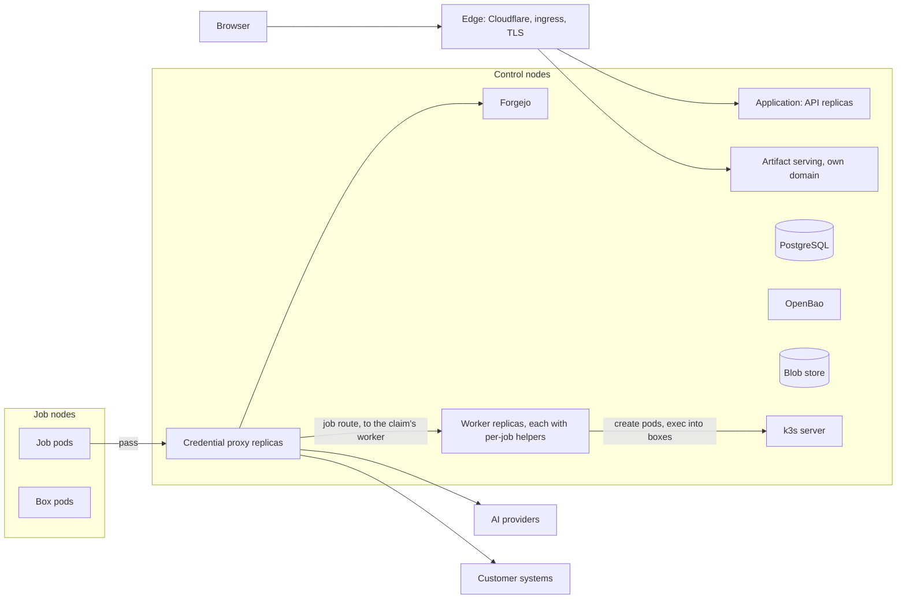

# Deployment, service architecture, and identity

A deployment for the complete application: a static frontend, API, authentication, investigation and learning
workers, knowledge publication, and artifact serving, on a small cluster of rented machines (VPS hosts) run by
**k3s** (a small Kubernetes distribution). The hosts bring the compute; the cluster places the services and the
per-job workloads on top of them. Any host runs any tenant's job, a lost host loses only the work it had in flight,
and the power to start workloads is an allow-list the cluster enforces, not a Docker daemon.

The file keeps its old name so links stay valid; Compose per host is now the fallback (section 1), not the plan.

## Decisions and scope

The selected direction is:

- **k3s** on one or more hosts, joining nodes to grow. Compose per host is the written fallback if the spike fails
  (section 1). Accept downtime and loss of in-flight work rather than buying high availability in advance.
- **Hosts are interchangeable compute** (B1). Durable state lives in PostgreSQL, blob storage, Forgejo and OpenBao,
  never on a host.
- **More than one worker per machine, workers in containers, more than one API replica** (owner, 2026-11-14).
- **Node pools:** control nodes run services and workers; job nodes run jobs and their boxes.
- **A job holds only its pass and reaches only the credential proxy** (B3). Model and forge calls go through the
  proxy too (#1491).
- **Tenants are separated by credential first and by network second** (B6): pod-to-pod traffic is denied by
  default.
- Serve static frontend assets behind Cloudflare and a TLS ingress.
- Authenticate browsers with a backend-held session: the backend keeps OAuth tokens server-side and the browser holds
  only an opaque HttpOnly session cookie. Each user belongs to exactly one tenant, a product constraint for now.
- Use PostgreSQL for application state, learning state (#1278), audit (the proxy's included), and transactional job
  coordination.
- Serve generated HTML from a separate registrable artifact domain. Renderer output runs only its fixed,
  fingerprinted script; model-written HTML is opaquely sandboxed.
- Schedule jobs on a slot-counted worker pool with capacity reserved for investigations.
- Use Tailscale SSH for administrative access.
- Collect application and operational telemetry centrally, separately from audit records and run evidence.
- Preserve the brain/hands split, with system access through controlled adapters.

Keycloak, OpenBao, the ingress, and the blob-storage backend are service recommendations. This document sets
architectural direction; it does not claim that production integrations are implemented.

**Sequencing (owner, 2026-11-14).** The API migration (#1083) completes first, at a single "API checkpoint" from
which a frontend can be built; the boundaries work order (end of the Design) follows it. The checkpoint must not
foreclose this design: flows that need host powers become jobs, never lifecycle host steps; run evidence goes to blob
under claim-scoped keys and is read only by confined readers; nothing new in the API reads a host's data folder.

## Principles

Inherit the [engineering principles](../../../docs/principles.md), [threat model](threat-model.md), and
[credential-free executor model](runtime-isolation-executor-model.md).

Model output and writable run files are untrusted. Arbitrary model-written code runs only in an executor. **A job is
not trusted** although it is deterministic product code: it parses attacker text (alert payloads, tool output, model
replies) through large parsing libraries and loads AI-written tenant adapters, so the threat model counts it as
hijackable (class 2: "a box around the brain reduces blast radius, not probability"). The credential proxy, not the
job, holds the model-provider key and every forge and customer-system credential (#1163, #1491). A run reaches a
credentialed system through the proxy with a signed pass, and the proxy obeys only the access declaration merged to the
tenant repository's protected `main`. Separate logical roles do not imply a security boundary unless their
credentials, processes, network access, and filesystem access are actually restricted.

Keep one authoritative owner for each kind of state. Git review governs published knowledge; databases coordinate
mutable workflow; artifact storage holds large run outputs. Keep infrastructure reproducible, resource use bounded,
and failures visible. Budget constraints do not weaken tenant authorization or isolation.

### Deployment boundaries (B1–B8)

- **B1. Hosts are interchangeable compute.** Nothing durable, nothing shared between jobs, nothing scoped beyond the
  jobs currently on it lives on a host. A host holds scratch for its current jobs and rebuildable caches. Losing a
  host means its in-flight jobs fail and retry.
- **B2. Every workload belongs to one zone, and a zone's reach is a short list enforced by the credentials it holds
  and by the network.** Zones: edge, application, control services, launcher, job, box (section 1).
- **B3. A job holds only its pass and reaches only the credential proxy.** It listens on nothing and dials nothing
  else. The pass is signed per tenant, names the job's claim, lasts at most 600 s, and is honoured only while that
  claim is the job row's live claim.
- **B4. The power to start workloads is an allow-list enforced by the orchestrator.** The launcher may create only
  pods whose security-relevant fields match the deployment's job or box templates: image digest (this deploy's and
  the previous one's, for rollouts), runtime class, security context, volume types and mounts, every `host*` field,
  service account and token mounting, `nodeName` (refused), node selector and tolerations, container count and
  command. Unknown volume types are refused; labels, resources and fields the orchestrator fills in are free. Enforced
  by a `ValidatingAdmissionPolicy` bound to the launcher's identity, on top of Pod Security "restricted". A
  compromised launcher cannot start a workload that escapes to its host. (OWASP Docker cheat sheet, Rule #1: "Do not
  expose the Docker daemon socket (even to the containers)"; Kubernetes cheat sheet: role-based access control, Pod
  Security Admission.)
- **B5. A job's life has one owner: its row.** A job or box pod is alive only while its claim label equals its row's
  live claim. Every other ending (worker gone, lease lapsed, cancel, teardown) reduces to that rule; never `/proc`,
  file locks or owner references.
- **B6. Tenants are separated by credential first and network second.** Pod-to-pod traffic is denied by default
  (Kubernetes cheat sheet: "By default, Pods are non-isolated for ingress and egress").
- **B7. Replicas where state can live in PostgreSQL; named singletons elsewhere.** Replicas: API, credential proxy,
  worker. Singletons, with downtime accepted: PostgreSQL, OpenBao, Forgejo, blob store, identity provider, and the
  k3s server with its datastore and cluster CA.
- **B8. Attacker bytes are read only where reading them is harmless.** Privileged processes (worker, helper, proxy)
  move job-written content unread, or read only small typed records under a schema and a size cap. Anything heavier
  (renderer, learning consumers, SQLite) runs in a confined job-shaped pod holding only its input (threat model class
  2, locus 3). No archive is ever unpacked by a privileged process.

## Intent

- **V1 — Complete deployment:** start the frontend, identity, API, storage, knowledge service, and workers from
  versioned cluster configuration.
- **V2 — Tenant authorization:** derive request tenant authority from the tenant in the request path, checked
  against the caller's active membership (#1306). Scope resource operations to that tenant. Machine authority is independently limited by tenant,
  job, and purpose.
- **V3 — Executor isolation:** confine model-written code to approved filesystems and resources without credentials,
  administration sockets, or network access. An unavailable isolation backend refuses visibly.
- **V4 — Execution ownership:** job claims, cancellation, completion, and cleanup have trusted owners. A job's row
  owns its life (B5): an expired lease alone never authorizes an overlapping run, because a pod whose claim is no
  longer its row's live claim is deleted and its pass refused.
- **V5 — Economical operation:** one small node is a complete deployment; capacity grows by joining nodes, with no
  Redis and no managed services required.
- **V6 — Safe presentation:** show model-controlled transcripts as data in the app; isolate independently generated
  HTML from the application's browser authority.
- **V7 — Operational visibility:** correlate requests, jobs, tools, and host activity while protecting customer
  payloads and credentials from general telemetry.

Boundary obligations (#1491), each with its observable check:

- **O1 — any host runs any tenant's job.** Two-node test: an investigation on node A, its learning job and post-step
  on node B, findings published.
- **O2 — losing a host loses only its in-flight jobs.** Kill a node in that test: nothing else is lost, nothing is
  "refused for good", the lost rows lapse and retry by today's rules.
- **O3 — many workers, anywhere.** Two or more worker replicas on one node or several, with no host lock, data-root
  lock or shared host path.
- **O4 — a job dials only the proxy.** From a job pod the proxy connects; another job or box pod, a worker pod,
  PostgreSQL, OpenBao, blob, the forge, the cluster API server, cluster DNS, the node's own address (kubelet, API
  server port, node ports), cloud metadata and an outside address do not, and no name resolves. Run on the production
  runtime.
- **O5 — a box reaches nothing.** The same test, with the proxy refused too.
- **O6 — a job holds nothing but its pass:** no provider key, forge token, database, OpenBao or orchestrator
  credential, no service-account token, nothing of another tenant.
- **O7 — the launcher cannot step outside the templates.** Any change to a security-relevant template field (B4's
  list) submitted with the launcher's identity is refused by the orchestrator; so are pod updates, ephemeral
  containers, PersistentVolume creation and any Secret read.
- **O8 — one audit trail, written before send,** in PostgreSQL, by every proxy replica, through an insert-only role.
- **O9 — dev and CI have the production shape** on one node (k3d), with the same templates, policies and runtime
  classes.
- **O10 — a pass dies with its claim.** A pass presented after its claim stopped being the row's live claim is
  refused while the database is reachable.

There is no availability or throughput guarantee, and no defence against a compromised control node or launcher: that
zone is trusted orchestration (decision B below). Not promised: high availability of singletons, zero-downtime
upgrades, automatic node provisioning, spending limits (#1431).

## Design

### 1. Cluster, zones, and services

**Why k3s.** Workers already pull work from PostgreSQL, so placing jobs needs no scheduler. What decided it is who
places long-lived services across machines, and who holds the power to start per-job workloads, and how narrowly.

| | Compose per host, containerised worker | Nomad | Kubernetes (k3s) |
|---|---|---|---|
| Launcher's power | the Docker socket: root on its host | Docker driver on each node (root); access-controlled job API | API server: role-based access + admission allow-list |
| Network policy across hosts | none; per-host firewall by hand | none built in | NetworkPolicy, enforced by the bundled controller |
| Services across hosts | by hand | yes | yes |
| Change from today | smallest; #1502's path, pid and socket translation stays | launch layer rewritten | launch layer rewritten |
| Learning value | low | medium | high |

k3s is the only option where B4 and cross-host B6 are enforced by something other than our own code. It starts on one
node and grows by joining. Costs: the launch layer is rewritten against the Kubernetes API; dev and CI need k3d with
gVisor inside it (works in the dev container; every node needs runsc's `gvisor-bin` folder beside it); the cluster itself is operated (upgrades, datastore backup and restore, the
cluster CA, Secret encryption at rest with `--secrets-encryption`, the network plugin).

**Fallback if the spike fails:** Compose per host, a containerised worker holding the Docker socket, the helper and job
socket as today. Still holds: B1 (with #1082), B3, B5, B8, O1–O3, O8, O10. Drops: B4 (the launcher is root on its
host), cross-host B6 (per-host bridges and firewalls), O7.

**Zones and reach.**



| Zone | Holds | Reaches |
|---|---|---|
| Edge | TLS keys | API, artifact serving |
| Application | API database role (row-level security), session store, identity-provider client secret, blob signing key | PostgreSQL, blob, identity provider |
| Credential proxy | per-tenant pass verification, system secrets, provider keys, forge logins (from OpenBao) | OpenBao, PostgreSQL, forge, providers, customer systems, worker pods (job route only) |
| Launcher (workers) | worker database role; OpenBao role reading every tenant's sign login; the orchestrator role below | PostgreSQL, OpenBao, blob, proxy, API server; accepts connections from proxy pods only |
| Job | its pass | proxy |
| Box | nothing | nothing |

**The launcher's orchestrator rights**, in the jobs namespace only: create, delete, get, list and watch pods; exec
into pods; get and list volume claims; create and delete Secrets, never read or list them. No PersistentVolumes, no
NetworkPolicies, no pod updates, no ephemeral containers. Exec cannot be narrowed by label, so the launcher can exec
into job pods as well as boxes; it gains nothing it does not already hold (every tenant's sign login), which is why the
launcher zone is named trusted orchestration. Jobs and boxes share one namespace because they share a volume claim,
and claims are per namespace.

**Node pools.** Control and launcher workloads run only on control nodes, job and box workloads only on job nodes, by
`node-restriction.kubernetes.io/` labels (which a node's own kubelet cannot set) and taints. The admission policy pins
them: `nodeName` refused, selector and tolerations fixed.

| Component | Responsibility |
| --- | --- |
| Ingress, proposed Caddy or the k3s default | TLS, static assets, explicit public routes and request limits. |
| Backend API | OIDC client and session store, JWT validation, tenant-scoped records and audit, job submission and status, artifact grants. No runtime administration and no host powers (#1083 S5). |
| Keycloak, proposed | Product OIDC issuer, external identity brokering, controlled membership and invites. Separate from lab identity services. |
| PostgreSQL | Application records, learning state, audit (the proxy's included), and durable job coordination. |
| Blob service | Run and episode evidence, transcripts, reports, HTML and assets; private storage with authorized artifact delivery. |
| Forgejo | Git storage with access control, branches, pull requests, review, and protected publication. |
| OpenBao, proposed | Workload authentication, pass signing, tenant login secrets and customer system credentials. |
| Credential proxy | Every outbound call a job makes: customer systems, model providers, the forge, and the job route to its helper. |
| Worker | Claims, the per-job helper, pod lifecycle, evidence publication and terminal status. |
| Job | The brain: LLM loop, provider client through the proxy, typed tool dispatch. |
| Box | Model-written commands in a gVisor sandbox with no network. |

Use authenticated connections and explicit network policy between services; database roles, issuer policies and
artifact grants constrain each zone. Private networking alone is insufficient. No workload but the k3s server holds
cluster administration.

### 2. Human identity and backend-held sessions

The backend is the OIDC client: it runs Authorization Code with PKCE as a confidential client with exact redirect
URLs. Keycloak is the proposed application issuer and can broker external identity providers; Google is one example,
not a product constraint.
[Keycloak supports external OIDC/SAML identity brokering](https://www.keycloak.org/docs/latest/server_admin/index.html#_identity_broker).
External login establishes a person, not tenant membership. Membership must be controlled by trusted enrollment and
invite administration, with one authoritative owner feeding issuer claims. Do not link accounts solely by matching
email.

Each user belongs to exactly one tenant. This is a product constraint, not a technical one: enrollment refuses a
second membership, and a person who needs two tenants uses two accounts. Lifting it later requires choosing the active
tenant at token issuance, with the issuer checking membership, never through a client-supplied selector.

The backend keeps the session in PostgreSQL (it holds no tokens) and gives the browser an opaque, HttpOnly, Secure,
host-only session cookie. The browser never holds OAuth tokens, so reload and refresh need no hidden IdP frame and are
unaffected by third-party cookie blocking. On each request the backend looks up the session and takes the person from
it. The tenant is the request path's (`/tenants/{T}/...`), accepted only for an active membership of that person, else
404; no tenant is in any token. A program presents a bearer credential (an API key, or a client-credentials token the
backend verifies: algorithm, signature/JWKS, issuer, audience, validity times). Resource queries and writes enforce
the path's tenant. Sessions live in PostgreSQL, so API replicas share them (B7).

Each request costs one session lookup; at this scale that is negligible. Deleting a session stops that browser
immediately, so logout and forced sign-out take effect at once. A membership change takes effect on the next request,
because membership is read per request, not carried in a token.

Cookie authentication requires request-forgery protection. Use `SameSite` session cookies and reject state-changing
requests whose `Origin` header is not the application origin. This matters because browsers treat subdomains of one
registrable domain as same-site.

Keep Keycloak administration private: its admin routes share its application listener, so restricting only the
management port is insufficient. Configure Cloudflare and ingress trust explicitly and prevent bypass through direct
origin access.

### 3. Brain, executor, and system access

The job runs the brain: trusted product code that calls the AI provider (through the proxy) and dispatches a fixed
tool surface. Model-selected shell commands go into the job's box, never into the job or an adapter process. A
compromised job can still use its own pass until its claim ends; the typed tool table limits normal model influence,
not code execution inside the job.

The box provides the working directory and bash and file tools. Approve its mounts, environment, CPU, memory, process
and disk budgets; exclude credentials, runtime sockets, and network access. gVisor is the backend; a microVM backend
remains possible behind the same template rule.

Adapters expose typed operations over an accepted tenant and configured system. Trusted code chooses endpoint,
identity, executable, and permitted operations, and every credentialed call goes through the proxy. MCP clients
connect only to approved servers. Learning receives only the integrations its workload needs.

#### Current shape: brain confinement as specified by #1170

Until the work order lands, every job runs in one Docker container of its own on a single execution host, started by
a **per-job host helper** (`python -m defender.job_host`, the worker's child). The helper is trusted product code and
holds what reaches more than one tenant: Docker, the shared database login, OpenBao's sign and forge logins. It
prepares the run folder, copies and exports, signs every pass (tenant, investigation or learning job id, grant,
600 s), mints the post-step's forge tokens, writes the post-step's records, and starts, relays and stops every box.
The job reaches it over a unix socket (the job socket), answered only to that container's processes, which the helper
recognises by host process ids; so the helper must share the Docker daemon's mount paths and process namespace, and
the worker runs natively on the execution host. The job container joins the network `DEFENDER_JOB_NETWORK` names (a
bridge network created for the jobs, judged once at the worker's start), holds the provider key, and mounts its
tenant's folder, the worker's code copy and its socket's folder. One worker runs per machine (a data-root lock), and one
execution machine holds the run evidence and tenant clones. The upgrade notes for #1170 in `defender/CLAUDE.md` give
the operational detail. The rest of this section is the target that replaces it.

#### Target: the helper's channel goes through the proxy

The helper stays what #1170 made it: trusted, one per claim, living in its worker, the job's only source of launch
facts, passes, boxes, records and hand-ins, with its per-claim state in memory. What changes is how the job reaches it.

- **The job reaches its helper through the proxy.** A job request is an ordinary HTTP request to the proxy's job
  route (`/v1/job/<request>`) carrying the job's pass. The proxy verifies the pass and its claim against the row
  (O10), reads the worker address the claim row records, and forwards the request there. Worker pods accept
  connections from proxy pods only; a job cannot connect to any worker. Each request is its own HTTP exchange, so
  concurrent requests from one job (learning siblings, parallel oracle boxes, a long box command) need no
  multiplexing, and large transfers are streamed, capped bodies.
- **The helper checks the caller itself.** The proxy forwards the pass with the request; the worker routes it to the
  helper of the claim the pass names, and that helper accepts only a pass it minted (it keeps their hashes) for a claim
  it holds live. A reused worker address, a policy gap or a compromised proxy then reaches nothing but replays of
  passes it has already seen.
- **Job-route limits:** per claim, a cap on concurrent requests and on bytes, so one job cannot starve other tenants'
  model calls; a deadline per request of its stated timeout plus a margin, under a hard ceiling; size caps enforced by
  counting bytes.
- **Lost answers:** a request that acts (box start, batch start, records, store writes) carries an id, and the helper
  answers a repeat with its first answer.
- **The proxy stays dumb on this route:** it checks the pass and claim, takes the destination from the row (never
  from the job), and passes bytes through unread (B8). Typed parsing happens in the helper.
- **Bootstrap:** the first pass is in a Secret named after the claim, mounted into the job pod; admission pins a job
  pod's secret volume to its own claim's name and refuses secret volumes on boxes. Later passes come from the helper on
  request. Leftover Secrets are deleted by name by the row-based sweep.
- **The job ends when its claim does.** The job renews its pass every minute; a refused renewal, or a few failed ones
  in a row, ends it. A starting worker fails the rows it held before (its helpers' state was in memory), so their
  passes are refused at once. This replaces "dies with its starter" and needs nothing from the API server.
- **Every job kind gets a pass that names its claim,** including an empty grant and the post-step.
- **Boxes** are reached by the helper through the orchestrator's exec, mapped from the box handles it minted for the
  claim, never from a pod name the job sends.
- Removed: the unix socket and its host-pid peer check, gVisor's daemon-wide `--host-uds=open` (#1469), the hand-off
  files (#1381).

Pod identity tokens are not used: the pass already identifies the job to the proxy, and a second credential would add
a second check. Job and box pods set `automountServiceAccountToken: false` under a service account with no rights;
admission refuses a projected token volume.

#### Target: pod lifetime (B5)

No owner references. A job or box pod carries `tenant` and `claim` labels. Every worker's periodic sweep deletes pods
whose claim is not their row's live claim (worker death, lapse and re-claim, cancel, teardown). Every pod has an
`activeDeadlineSeconds` above its job kind's longest allowed run, as the outer bound. The helper deletes a job's boxes
before the job; the sweep covers a helper that died between the two.

#### Target: boxes as pods

Each box kind (the run's shell box, the oracle box, the batch box) has its own template, because their mounts differ.
A box pod uses the gVisor runtime class whose handler sets `--network=none`, a deny-all network policy as the second
layer, `dnsPolicy: None` with the one nameserver `127.0.0.1`, where nothing listens (the API refuses `None` with
no nameserver), and no service-account token. It mounts the job's volume: a generic
ephemeral volume of the k3s local-path storage class, declared on the job pod and created and deleted with it;
single-node access places the box on the job's node. Read-only stages that the job could rewrite on its own volume are
re-checked by digest when a box starts on them.

The batch box is stopped between agent runs today; a pod cannot be stopped and restarted, so each window becomes a
delete and a create (seconds per agent run), and only the volume survives between windows.

### 4. Jobs, workers, and capacity

Use one worker codebase and image with fixed investigation and learning handlers. Workers are replicas (B7): any
number per node, on any control node, coordinating only through PostgreSQL. Nothing in a worker listens for another
worker.

The worker pool counts capacity in **slots**, roughly one brain plus its executor, not in jobs. A slot is counted per
worker. An investigation needs one slot, and so does a learning job: a job's sibling worlds run one after another,
control first, so a slot holds one family (#1344; operator-started families keep running their worlds together). A
worker has `slots` S (default 3) and `learning slots` L, both the guarantee and the limit for learning-class work
(family steps and the post-steps that follow them), 0 ≤ L ≤ S − 1, defaulting to min(1, S − 1) in the deployed
settings; L = 0 is the off switch. A worker with a free slot picks, in order (#1344 r5 "Scheduling"):

1. if fewer than L learning-class tasks run and a job is queued: the oldest job;
2. otherwise the oldest investigation.

There is no preemption and no priority that grows with time waited. A queued job's first attempt past an age limit
(default 24 h) is skipped when a pick reaches it, so under sustained load some jobs expire rather than queue without
bound. Budget aggregate brains, parsers, adapters, provider requests, memory, disk, and spend as well as slots;
learning has no spending cap until #1431.

The cluster places pods by declared CPU and memory. A job whose pod cannot be placed within a start limit releases its
claim **without spending an attempt**, with back-off; it never runs unconfined.

The API commits an investigation or learning-job record, then announces its audit event (a log event after the
commit; #1342 O13). Job status and claim fields belong
to those domain records. Workers poll and claim through PostgreSQL with short transactions and fenced ownership. The
API observes status through the same database, never by a synchronous call to a worker. PostgreSQL documents
[queue-style locking with SKIP LOCKED](https://www.postgresql.org/docs/current/sql-select.html).

**The claim lives on the row.** The claim transaction writes the claim token and the worker's address on the row.
**Live** means the row is running and unfinished under that claim, not "lease unexpired": a lapsed row nobody took
over may renew and recover; a take-over fails the old claim, so its passes are refused and the sweep deletes its pods.
Post-steps, which hold no row today, get one, so the same rule covers them.

The worker reports progress, validates collected outputs, transfers artifacts, and commits terminal state. The job
cannot declare its own success beyond its typed outcome record. Fenced writes reject stale claims, and the claim check
at the proxy stops a stale job's model spend and system calls at its next request. A stopping worker hands its rows
back so they are retried within seconds; each redeploy during an investigation uses one of its three attempts. A worker
restart ends its jobs, which retry.

**Worker stop timeout: 45 s.** A stopping worker gives its jobs `stop_grace` (30 s) to end, then writes each row's last
figures. The worker pod sets `terminationGracePeriodSeconds: 45` (more than `stop_grace` plus the writes); a shorter
timeout kills the worker mid-stop and the rows lapse instead of being handed back.

The exact fencing, retry, cancellation, and termination protocol remains a contract to settle, not an exactly-once
guarantee.

### 5. Storage ownership

| Data | Authoritative owner |
| --- | --- |
| Tenants, application users, investigations and jobs, audit (the proxy's included) | PostgreSQL |
| Findings, curation and delivery records (#1278) | PostgreSQL, `learning` schema |
| Human login, sessions, membership used for token issuance | Product identity provider; exact enrollment ownership remains to settle |
| Published lessons, queries, agent knowledge, reviews, retained branches | Tenant repositories in Forgejo |
| Run and episode outputs and large immutable evidence | Blob storage, under claim-scoped keys |
| Provider and system secrets, tenant login secrets, workload grants | OpenBao |
| Job scratch | The job's ephemeral volume, deleted with its pod |

What moves off hosts, item by item (B1, B8; #1082 owns the move to blob):

| On a host today | Target |
|---|---|
| Run folder (report, session database, logs, records) | On the job's volume during the run. At the end the job pushes named, size-capped objects through the job route; the helper stores them in blob unread, under a key that includes the claim; a database transaction that checks the claim makes them the run's, so a stale helper cannot overwrite a retry's objects. The worker reads only the small typed outcome record. |
| Readers of run evidence | Learning jobs and post-steps already are confined readers. The run-page renderer and other presentation code run in a confined reader pod; the helper's run-page mirroring moves into the job, which pushes the page. |
| A learning job's source run; a post-step's episodes | Pulled by id through the job route (the helper reads blob, the tenant from the claim). A missing object is a store fault and the job fails; findings are never "refused for good" for it. |
| Tenant knowledge clone, exports, run copies, drafts | Built by the helper from the forge's protected `main` (a per-worker cache allowed) and pulled by the job. Helper requests that return host paths today are redesigned as pulls. |
| Retained branches | In the forge. A forge-use pass may push only to its batch branch; merges stay with trusted code. A host lost mid-batch loses that batch's unpushed work, which is redone. |
| The worker's code copy | Gone: the image carries the code, pinned by digest per deploy. |
| Tenant login secret files | OpenBao KV, written once by the lifecycle at install, read by the worker role (sign) and the proxy (forge). |
| Proxy audit file | A PostgreSQL table, written through an insert-only role. |
| Host lock, data-root lock, process-id owners | Gone (#1369, #1434). |

**Order constraint:** no second node and no second worker until run evidence and the learning source are in blob;
before that, O1 and O2 are false and the post-step loses findings.

The learning store is reached from a job through the helper, as typed operations on the job route (never SQL); the
tenant comes from the claim, never from a field (#1487).

The application run viewer displays transcripts and other model-controlled strings using safe text rendering or
sanitized markup.

Generated HTML is served from a **separate registrable artifact domain**, not a subdomain of the application's domain.
HttpOnly stops a script from reading the session cookie but not from using it. A report on the application origin
could call the API with the user's authority, and one on a sibling subdomain is still same-site, so a form there could
carry the session cookie. A separate domain removes that class of attack. Per-tenant hostnames under it, such as
`<tenant>.<artifact-domain>`, are one wildcard level and fit Cloudflare's free edge certificate; a second wildcard
level would need a paid certificate. Unknown tenant hosts refuse. One serving deployment handles all hostnames.

Artifact HTML comes in two kinds, served under different restrictions:

- **Renderer output.** Product renderers emit a page with one fixed script of our own. Model data is embedded as inert
  JSON data islands. Serve it with a CSP that allows only that script by its fingerprint and blocks network calls,
  forms, framing, and other scripts. The serving layer owns the fingerprint list; the renderer runs on hostile input
  and cannot add to it. The document keeps a normal origin, so cookies work.
- **Model-written HTML**, if any product path serves it. It runs in an opaque sandbox with no same-origin authority,
  with navigation, forms, popups, and network destinations restricted, for direct navigation as well as the iframe.

Delivery of renderer output: the application issues a short-lived, one-time link bound to tenant and object scope. The
artifact server exchanges it for a host-only HttpOnly cookie scoped to that tenant hostname and run, then redirects to a
URL without the grant. Relative assets and sibling links within the run then carry authorization with no grant in the
URL. Opaque-sandboxed documents do not send cookies on their requests; if they need relative assets, carry the grant in
the URL path rather than the query string, and send no referrer.

Share no application tokens or cookies with artifact origins, grant no broad CORS access, and preserve hostname and
authorization scope through caching. Keep grants out of logs and third-party resources. Origin routing never replaces
object authorization. Exact CSP values and the complete inventory of HTML-producing paths require a renderer contract
before deployment.

### 6. The credential proxy

- **Stateless replicas behind one Service.** Network policies select the proxy pods (policies match after address
  translation); jobs reach the Service's cluster address with no DNS, and the proxy's certificate names that address.
- **Claim check (O10).** In the transaction that writes the audit line before sending, the proxy checks that the
  pass's claim is the row's live claim. The check runs once per request, at its start: a model call already streaming
  runs to its upstream timeout after the claim dies. The proxy's role gains read on claim rows.
- **Database outage.** Audit is fail-closed, so with audit and the claim check both in PostgreSQL an outage stops
  every proxied call, model calls included, and a stolen pass gains nothing then. Those failures end as provider
  failures (#1491 decision 3). An outage longer than a few renewal periods ends every job.
- **Egress, decided per route (#1501).** Tenant-declared system routes refuse private, loopback, link-local, metadata
  and cluster addresses, judged on the address actually connected, on every leg, with no redirects. Forge and provider
  targets come from proxy configuration only. An egress policy on proxy pods allows the named OpenBao, PostgreSQL and
  forge and denies other cluster and node addresses.
- **Model and forge calls** go through the proxy (#1491); the post-step's raw forge token is retired.
- The lab and playground-v2's frozen proxy run as a second named proxy deployment in their own namespace, with their
  own policies; frozen runs start no job pods.

### 7. Machine identity and trust

OpenBao is the proposed issuer in development and production. It stores customer system credentials (KV v2, written
whole through a write-only role, read only by the credential proxy), tenant login secrets (KV, written once by the
lifecycle at install), and signs passes (transit, one key per tenant; the launcher may only sign and the proxy may only
verify) (#1163). Its address is a setting, not a fixed service name.

OpenBao encrypts its storage with a key it never writes to disk. After every start it is sealed until that key is
supplied. A copied disk, snapshot, or backup therefore reveals nothing, but a root user on the running node can still
reach the key in memory. While sealed, workers cannot sign passes and the proxy cannot read credentials.

- **Development:** OpenBao's built-in static key seal, with the key in a file outside Git and outside model-visible
  mounts. Acceptable only in development.
- **Production, initially:** manual unseal by key-share holders, with an alert whenever OpenBao is sealed. Accepted
  downtime makes this tolerable; reboots are rare.
- **Production, later:** automatic unsealing through an external key service (a small AWS or Google dependency,
  around $1 a month). Choose it explicitly when manual unsealing becomes a burden. OpenBao 2.7 moves cloud key-service
  seals into plugins.
- **CI/CD never holds unseal keys.**

Workers authenticate to OpenBao with a workload mechanism (proposed AppRole) and delegate tenant and purpose
authority to a job only as passes: the helper signs each pass (tenant, job id, grant, claim, at most 600 s) for the
claim it holds (P-B: whoever decides a pass's scope is the only one who signs it). A pass is honoured only while its
claim is live (O10). Automation may create knowledge branches and pull requests; it cannot push or merge protected
`main`. Model-written code receives no issuer or Forgejo credential.

| Boundary | Authority and limit |
| --- | --- |
| Browser to API | HttpOnly session cookie, with `Origin` checks on writes. The path's tenant, checked against membership, scopes resource access. Session deletion is immediate; membership changes take effect on the next request. |
| CI/CD to cluster | Deploy credentials only, reaching the cluster over Tailscale as an ephemeral tagged node; no unseal keys or tenant secrets. |
| Cloudflare to origin | Explicit web routes and trusted ingress configuration; administration remains private. |
| Worker to orchestrator | The launcher role (section 1) under the admission allow-list (B4). |
| Job to proxy | Its pass, honoured while its claim is live; the job route reaches only its own claim's helper. |
| Job to helper | Typed requests through the proxy's job route; passes the helper minted, boxes the helper started, records and pulls by job kind. |
| Helper to box | Exec through the orchestrator, from box handles minted for the claim. |
| Box | Nothing: no network, no credentials, no token. |
| Operator to nodes | Tailscale SSH identity and least-privilege host policy, separate from product tenant membership. |

**What a compromised node reaches (decision B).** A compromised job node yields the passes and run data of the jobs on
it at that moment (passes die with their claims), plus the ids and tenant labels of pods cluster-wide (a kubelet may
list pods). A compromised control node, or launcher, reaches every tenant.

### 8. Tenant lifecycle and operator commands

The lifecycle has no host steps: prepare creates rows, the forge repository and OpenBao entries; teardown cancels the
tenant's jobs through the job model (#1368), whose rows' ending makes the sweep delete the tenant's pods cluster-wide,
and removes the tenant's blob prefix. The lifecycle's "host" actor merges into the lifecycle service.

By-hand commands that touch a tenant (a run by hand, the tenant and policy command lines, the learning drains) become
jobs submitted through the job model, as #1361 and #1369 decided, and so run in pods under the same templates.
Tenant-less developer tooling (experiments, the evaluations harness) stays outside the deployment with a developer's
own key (#1491 decision 1).

### 9. Operations and observability

Use Tailscale SSH from an enrolled operator device to each node, with explicit network and SSH policy and
reauthentication for privileged access. Keep cluster and service administration private and use port forwarding where
useful. Maintain a provider-console recovery path.
[Tailscale SSH](https://tailscale.com/docs/features/tailscale-ssh) supplies identity-based SSH policy over the private
network.

Proposed deployment path:

- GitHub Actions builds immutable images and pushes them to GitHub's container registry.
- The deploy job joins the tailnet as an ephemeral, tagged node allowed to reach only the cluster's API.
- It applies versioned manifests naming images by digest; the admission policy admits this deploy's digests and the
  previous deploy's, so a rollout can finish.

The pipeline holds deploy and registry credentials only, never unseal material, issuer credentials, or tenant secrets.
Coordinate API and worker schema compatibility. Initially stop admissions and drain work for disruptive migrations
rather than promise rolling upgrades. Cluster upgrades, datastore backup and restore, node patching, disk pressure,
issuer custody, DNS and TLS remain operator responsibilities.

| Record | Collection and storage |
| --- | --- |
| Audit | Authoritative application and security events in PostgreSQL, the proxy's included; transactional with domain changes where possible. Issuer, Forgejo, Cloudflare, SSH and cluster audit events are collected with their actual delivery guarantees. |
| Run evidence | Tenant-authorized blob artifacts, including transcripts and model and tool records; not copied wholesale into general logs. |
| Operational telemetry | Structured logs, metrics, and traces through a collector on each node to a central backend. |

Extend existing JSON logging and tenant and run context. Correlate service and version, node, request, tenant, job
and run, claim and attempt, and trace identifiers. Instrument API, queue execution, AI-provider calls, adapters,
publication, and cleanup with [OpenTelemetry](https://opentelemetry.io/docs/collector/deploy/agent/) where applicable.
Job and box stdout reach node log files, so nothing secret is printed there.

Monitor API error and latency, queue depth and oldest age, claim loss, active jobs and boxes, unplaceable pods, failed
cleanup, model spend, adapter failures, disk and memory, and service availability. Put high-cardinality identifiers
in logs and traces rather than metric labels. Start with alerts for unavailable services, stranded work, resource
exhaustion, and unexpected spend.

Bound collector queues and local log rotation. Telemetry loss must be visible without filling disks or silently
blocking work. Do not log credentials, passes, signed URLs, or raw customer prompts and payloads into general
telemetry. This deployment does not promise tamper-proof evidence against a compromised administrator.

### 10. Cost, shutdown, and growth

One node is a complete deployment (control and job pools on one machine, with the pool separation then only a label).
Grow by joining a job node, then a second one; a control node holds the singletons and their volumes, which need
backups. Because job nodes hold nothing durable (B1), a job node can be deleted after it is drained, with no state to
transfer. Most providers bill a powered-off server, so saving money means deleting it.

Keep reproducible configuration versioned and bootstrap and unseal material outside disposable nodes, outside Git, and
outside model-visible mounts. Partial restores must not combine incompatible tenant, issuer, Forgejo, cluster and
application state.

### Work order

**First, the API checkpoint** (#1083): the real server on PostgreSQL and Keycloak (#1498) and removal of the demo server
(#1496); tenant configuration through the API (#1470) with the real connection check (#1460); the remaining operator
flows as API requests (#1471); run pages and artifacts in the browser (#1161 and the artifact half of #1082); the
learning post-step's store access (#1487). Built in this design's shape: host-power flows as jobs, evidence in blob under
claim-scoped keys with confined readers.

**Then the boundaries work**, each a later issue:

1. **Spike, go or no-go (#1509):** dev leg run on 2026-11-14, every probe passes (results on #1509). Still to
   run: several nodes and a k3s server restart. It is a one-time check, not kept; the lasting checks of
   O4, O5 and O7, in CI as well, are the launcher's own tests in work item 7.
2. The claim on the row; passes name their claim; the proxy's claim check and audit in PostgreSQL.
3. #1491: model and forge calls through the proxy, the raw forge token retired, proxy replicas, per-route egress
   (#1501).
4. Tenant login secrets into OpenBao; the OpenBao address as a setting; a lifecycle with no host steps.
5. The job route through the proxy (#1469 and #1381 dissolved).
6. Operator commands as jobs, for whatever #1471 did not cover.
7. The launcher on the orchestrator: templates, admission policy, boxes as pods, the row-based sweep (#1502 rewritten).
8. Delete the host lock, data-root lock, process-id owners and code copy (#1369, #1434).
9. A second node and the two-node tests (O1, O2).

## Decisions (owner, 2026-11-14)

- **A. Orchestrator: k3s**, with Compose per host as the written fallback.
- **B. Node pools.** Alternatives were one pool (fewer machines; any node compromise is everything) or a pass-signing
  service that signs only for a claim the asking worker holds (narrows a launcher compromise; one more service).
- **C. Boxes as pods sharing a local-path volume with their job.** Boxes as containers in the job pod were rejected: a
  pod's containers share one network, so the box would gain the job's route to the proxy, and a pod's container list is
  fixed while boxes start on demand.
- **D. Operator commands become jobs** through the job model, not a standing tooling pod with tenant access.
- **E. The job reaches its helper through the proxy's job route** to the worker its claim row names. Rejected: the
  helper attaching to the job's stdin and stdout (no inbound path to workers, but it needs an in-pod broker,
  multiplexing, chunked frames and reattach, and without reattach a k3s restart kills every job).

## Accepted trade-offs

- A job node compromise reveals in-flight jobs' data on that node.
- A worker restart ends its jobs (they retry).
- A database outage stops every proxied call, model calls included, and one longer than a few renewal periods ends
  every job. This retires #1170's O6 ("a database outage stops no pass").
- A proxy restart or rollout fails in-flight helper requests of every job (box faults the run already handles).
- Box commands in flight fail when the k3s server restarts.
- Singletons, the k3s server included, are single points of failure; downtime accepted.

## Remaining decisions

- VPS providers and sizes, and actual resource budgets.
- Several nodes and a k3s restart (work item 1, #1509); the spike's dev leg passed. The fallback applies if they fail.
- Membership and enrollment owner, token lifetime and refresh configuration, and identity-provider setup.
- Issuer bootstrap and live Forgejo integration; when to adopt automatic unsealing.
- Exact artifact CSP values and the complete inventory of HTML-producing paths.
- Blob and observability backends, retention, privacy settings, and spending limits.
- Resumable learning episodes, needed to pause between siblings or to survive restarts.

## Related architecture

The [platform draft](../platform-design.md) supplies broader domain and API context, but assumes one investigation
container owns execution, store writes, and completion. This document follows the accepted brain/hands separation
instead. [Platform umbrella #1131](https://github.com/beetroot-salad/cyber-response-agent/issues/1131) carries the
ordered checklist. #1502 (containerisation) is rewritten as work item 7; #1491 is un-parked as work item 3.

## Grounding and review

Revision 2026-11-14, at source base `a8143a4bc`. The boundaries design went through four independent reviews (general,
trust boundaries, and two on the helper channel), each sorted by a fresh reader before revision. Kubernetes and gVisor
behaviour was then probed by the spike in the dev container's own Docker daemon (B-G7: the dev leg holds; several nodes and a
k3s restart stay unprobed).
Earlier revisions: 2026-10-22 and 2026-10-22b (Compose per host, backend-held sessions, one tenant per user, the
artifact domain, the OpenBao unseal posture); their claims are kept below.

<details>
<summary>Supporting source evidence and unverified behavior</summary>

```yaml
claims:
  # 2026-11-14 revision (deployment boundaries), base a8143a4bc
  - id: B-G1
    kind: census
    claim: "Job claims carry no host affinity; any worker claims any tenant's job."
    probe: "read jobs/store.py:307-330, 719-760, 815-822"
    probe_kind: read
    observed: "No predicate on host or preparation location."
    verdict: holds
  - id: B-G2
    kind: referential
    claim: "A tenant's login secret is one file on one host, from a once-unwrappable token."
    probe: "read lifecycle/_host.py:155, tenancy/models.py:173, tenancy/_approle_login.py:3-9"
    probe_kind: read
    observed: "Each generation records one host_secret_file and sign_secret_file path."
    verdict: holds
  - id: B-G3
    kind: referential
    claim: "A post-step that finds no episode folder marks its findings refused for good."
    probe: "read learning/branch/post_step.py:190-195"
    probe_kind: read
    observed: "FileNotFoundError on the episode folder leads to a permanent refusal."
    verdict: holds
  - id: B-G4
    kind: census
    claim: "Nothing in the worker, helper or job listens for peer workers; workers coordinate only through PostgreSQL."
    probe: "grep -rn '\\.bind(\\|\\.listen(\\|serve_forever\\|start_server\\|create_unix_server\\|uvicorn' defender --include=*.py, excluding tests"
    probe_kind: search
    observed: "Only the credential proxy serves (uvicorn); _io.bind hits are folder binds. The job socket server is per helper, for its own job."
    verdict: holds
  - id: B-G5
    kind: referential
    claim: "The helper starts boxes of kinds shell, oracle and batch on request, so a job's boxes are dynamic."
    probe: "read job_host/_investigation.py:184, job_host/_learning.py:620-622"
    probe_kind: read
    observed: "registry.box_kind for shell (investigation, learning), oracle (learning), batch (post-step)."
    verdict: holds
  - id: B-G6
    kind: referential
    claim: "OpenBao's address is hard-coded to the compose service name."
    probe: "read configuration/issuer.py:15"
    probe_kind: read
    observed: "OPENBAO_URL = 'https://openbao:8200'."
    verdict: holds
  - id: B-G7
    kind: behavior
    claim: "In k3s, deny-by-default NetworkPolicy leaves a job pod only the proxy pods, its own node included; a gVisor runtime class whose handler sets network=none gives a pod loopback only; two gVisor pods share a local-path volume coherently; a ValidatingAdmissionPolicy refuses every change to B4's fields; the launcher's role allows only what section 1 lists; all of it in the dev container."
    probe: "the #1509 spike run (scripts not kept; results on the issue): k3d v5.8.3, k3s v1.33.9 (containerd 2.1.5), runsc release-20261109.0, the dev container's jobs daemon (Docker 29.9.3), one node"
    probe_kind: executed
    observed: "All pass, each against a control. Job pod under policy: proxy pod and Service open; worker, other job, the node's kubelet, API server port and NodePort, API server Service, DNS, outside closed (all open with no policy). Box: loopback only, with or without policy. Volume: 11 of 11 coherence checks in both directions; the claim goes with the job pod. Admission: 2 templates admitted, 40 changes refused by the policy alone with Pod Security off; ephemeral containers and pod updates refused for every caller. dnsPolicy None needs a nameserver: 127.0.0.1 pinned, nothing resolves. Each node needs runsc's gvisor-bin folder. Box create-to-ready median 0.97 to 1.95 s."
    verdict: holds
  - id: B-G7b
    kind: behavior
    claim: "The same holds across several nodes and through a k3s server restart (exec streams in flight); on a CI runner it is covered by work item 7's tests, not by the spike."
    probe: "a two-node run; the launcher's tests in work item 7"
    probe_kind: executed
    observed: "not run"
    verdict: unprobed
  - id: B-G8
    kind: referential
    claim: "OWASP guidance cited."
    probe: "fetched cheatsheetseries.owasp.org Docker_Security_Cheat_Sheet and Kubernetes_Security_Cheat_Sheet, 2026-11-14"
    probe_kind: read
    observed: "Docker Rule #1 'Do not expose the Docker daemon socket (even to the containers)'; Rule #5 inter-container connectivity; Kubernetes: 'By default, Pods are non-isolated for ingress and egress'; disable automatic token mounting when not needed; Pod Security Admission; least-privilege RBAC."
    verdict: holds
  - id: B-G9
    kind: referential
    claim: "The proxy checks a pass's signature and expiry only; its claims are {tenant, investigation, grant, exp}; lifetime 600 s."
    probe: "read credential_proxy/_app.py (_verified, _CLAIM_KEYS), kit/access.py:77"
    probe_kind: read
    observed: "as claimed"
    verdict: holds
  - id: B-G10
    kind: referential
    claim: "The post-step is handed a raw forge token by the helper."
    probe: "read job_host/_learning.py:613-614"
    probe_kind: read
    observed: "forge.token registered for POST_STEP"
    verdict: holds
  - id: B-G11
    kind: referential
    claim: "The claim token is minted by the worker and stored in no column; post-steps hold no row; proxy audit is fail-closed."
    probe: "read job_host/_main.py:267, worker/_held.py:10, credential_proxy/_app.py:245-249"
    probe_kind: read
    observed: "as claimed"
    verdict: holds
  # 2026-10-22 and 2026-10-22b revisions
  - id: AUTH-C1
    kind: referential
    claim: Existing Forgejo identity integration requires an explicitly authenticated issuer client.
    probe: Read defender/learning/author/version_control/auth.py and delivery.py during the discussion.
    probe_kind: read
    observed: ForgejoIdentity accepts an authenticated HTTP client and requests an issuer role token with tenant and lifetime checks.
    verdict: holds
  - id: AUTH-C3
    kind: referential
    claim: Existing live Forgejo test fixtures do not validate real OpenBao workload login.
    probe: Read defender/tests/tenancy/tenant_1108_delivery/test_live_forgejo.py during the discussion.
    probe_kind: read
    observed: The test fakes the issuer response and signs a local fixture JWT.
    verdict: holds
  - id: AUTH-C5
    kind: behavior
    claim: Real OpenBao login and tenant-restricted JWT issuance interoperate with Forgejo.
    probe: Pending integration execution against the selected issuer and Forgejo configuration.
    probe_kind: executed
    observed: No real-issuer integration probe was executed.
    verdict: unprobed
  - id: VPS-C1
    kind: referential
    claim: API interfaces distinguish principal authentication, atomic writes with audit, and artifact URLs on their own origin.
    probe: Read defender/api/ports.py at the recorded grounding revision.
    probe_kind: read
    observed: Principal and Authenticator define the identity seam; WriteTransaction documents atomicity; ArtifactLinks requires short-lived links on the blob origin.
    verdict: holds
  - id: VPS-C4
    kind: referential
    claim: Existing diagnostics and run evidence provide a starting point for centralized observability.
    probe: Read defender/_log.py and docs/runtime-development.md.
    probe_kind: read
    observed: JSON diagnostics bind tenant_id and run_id; runtime documentation identifies per-run model and tool evidence logs.
    verdict: holds
  - id: VPS-C7
    kind: referential
    claim: The run report embeds one fixed product script and carries model data as inert JSON data islands.
    probe: Read defender/presentation/visualize_run.py and visualize_runtime.py.
    probe_kind: read
    observed: The page inlines RUNTIME_JS from a product asset; tool payloads are emitted as script type application/json with "<" escaped. Other HTML producers were not inventoried.
    verdict: holds
  - id: VPS-C8
    kind: referential
    claim: Learning siblings currently start together, but no stated requirement depends on concurrency.
    probe: Read defender/learning/branch/cli.py and docs/learning-development.md.
    probe_kind: read
    observed: A barrier starts every sibling together; no rationale tying results to simultaneous execution was found.
    verdict: holds
```

Code map (base `a8143a4bc`) for the boundaries work:

| Concern | Where |
|---|---|
| Claims, renew, retry | `jobs/store.py:307-330,503,578-660,625,719-760` |
| Worker start: data-root lock, code copy, job network check | `worker/_start.py:139-222` |
| Startup sweep by helper liveness | `worker/_containers.py:58-66` |
| Post-step holds no row | `worker/_held.py:10` |
| Helper: job container, peer check, claim token | `job_host/_container.py:50,195-258`, `job_host/_server.py:73-93`, `job_host/_main.py:267` |
| Helper requests returning host paths; empty grant gets no pass | `job_host/_common.py:39-62,75,93-99,102-123,150,223-224`, `job_host/_learning.py:493,613-622`, `job_host/_investigation.py:184` |
| Box kinds and mounts; run-page mirroring | `job_host/_learning.py:298,590,594-604`, `job_host/_investigation.py:159,165` |
| Job socket codec | `job_socket/__init__.py:53,57,125,131` |
| Box lifecycle and relay | `box/_lifecycle.py:872,1156`, `box/_docker.py:382,446-494`, `box/_relay.py:40-94` |
| Pass verification and lifetime | `credential_proxy/_app.py:245-249` (`_verified`), `kit/access.py:77` |
| Tenant tied to its preparing host | `tenancy/models.py:173`, `tenancy/_tenant.py:490-500`, `learning/branch/post_step.py:190-195` |
| Host lock and owners | `tenancy/host_lock.py`, `tenancy/_owner.py:26-90` |
| Lifecycle actor and teardown | `lifecycle/_job.py:27-42`, `lifecycle/_teardown.py:21-71` |
| Learning source run; author takeover | `learning/branch/job_entry.py:219-242`, `learning/core/store_tick.py:606-650` |
| OpenBao address | `configuration/issuer.py:15` |

</details>
