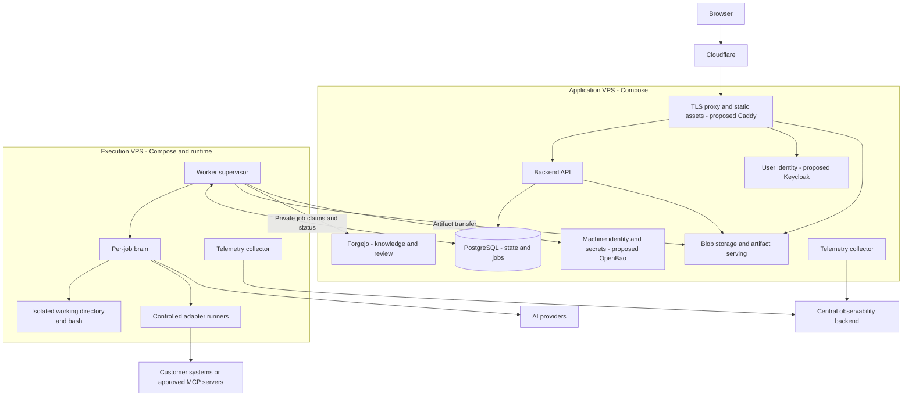

# VPS deployment, service architecture, and identity

A low-cost deployment for the complete application: a static frontend, API,
authentication, investigation and learning workers, knowledge publication, and
artifact serving. Application services and execution workers run on **different
VPS hosts**, each managed with Docker Compose.

## Decisions and scope

The selected direction is:

- Self-host with Compose; no Kubernetes initially. Accept downtime and loss of
  experimental data rather than buying high availability in advance.
- Separate the application host from the execution host and its runtime privileges.
- Serve static frontend assets behind Cloudflare and a TLS reverse proxy.
- Authenticate browsers with a backend-held session: the backend keeps OAuth tokens
  server-side and the browser holds only an opaque HttpOnly session cookie. Each user
  belongs to exactly one tenant, a product constraint for now.
- Use PostgreSQL for application state, audit, and transactional job coordination.
- Confine brains and output processors separately from the privileged launcher.
- Serve generated HTML from a separate registrable artifact domain. Renderer output runs
  only its fixed, fingerprinted script; model-written HTML is opaquely sandboxed.
- Keep execution-host learning state on a detachable block volume so the server can
  be deleted without losing it.
- Schedule jobs on a slot-counted worker pool with capacity reserved for investigations.
- Use Tailscale SSH for administrative access.
- Collect application and operational telemetry centrally, separately from audit
  records and run evidence.
- Preserve the brain/hands split, with system access through controlled adapters.
  The execution isolation implementation remains selectable, including microVMs.

Keycloak, OpenBao, a Caddy proxy, and the initial blob-storage backend
are service recommendations. PostgreSQL is selected for application state and jobs.
**Moving findings and curation workflow state to PostgreSQL is a follow-up,
[#1278](https://github.com/beetroot-salad/cyber-response-agent/issues/1278)**,
summarized below; the first deployment does not depend on it. This document
sets architectural direction; it does not claim that production integrations or
that migration are implemented.

## Principles

Inherit the [engineering principles](../../../docs/principles.md),
[threat model](threat-model.md), and
[credential-free executor model](runtime-isolation-executor-model.md).

Model output and writable run files are untrusted. Arbitrary model-written code
runs only in an executor. Trusted orchestration holds the model-provider key; **no run
process, adapters included, holds a customer system credential** (#1163): those live in
OpenBao and only the credential proxy reads them. A run reaches a credentialed system through
the proxy with a signed request token, and the proxy obeys only the access declaration merged
to the tenant repository's protected `main`. Separate logical roles do not imply a security
boundary unless their credentials, processes, network access, and filesystem
access are actually restricted.

Keep one authoritative owner for each kind of state. Git review governs published
knowledge; databases coordinate mutable workflow; artifact storage holds large
run outputs. Keep infrastructure reproducible, resource use bounded, and failures
visible. Budget constraints do not weaken tenant authorization or isolation.

## Intent

- **V1 — Complete deployment:** start the frontend, identity, API, storage,
  knowledge service, and workers through reproducible host configurations.
- **V2 — Tenant authorization:** derive request tenant authority from verified,
  issuer-controlled claims held by the backend session. Scope resource operations to that tenant. Machine
  authority is independently limited by tenant, job, and purpose.
- **V3 — Executor isolation:** confine model-written code to approved filesystems
  and resources without credentials, administration sockets, or network access.
  Select the isolation backend explicitly; an unavailable backend refuses visibly.
- **V4 — Execution ownership:** job claims, cancellation, completion, and cleanup
  have trusted owners. An expired lease alone cannot authorize an overlapping run:
  everything a run starts on a machine dies with the process that started it (a
  worker's child dies with the worker, a run's box with the child), so a lapsed
  lease is taken over in the database without reaching any machine (#1343).
- **V5 — Economical operation:** support a small application host and a separately
  stoppable execution host without requiring Redis or a cluster orchestrator.
- **V6 — Safe presentation:** show model-controlled transcripts as data in the app;
  isolate independently generated HTML from the application's browser authority.
- **V7 — Operational visibility:** correlate requests, jobs, tools, and host activity
  while protecting customer payloads and credentials from general telemetry.

There is no initial availability or throughput guarantee. Neither host has been
selected or sized. Separate hosts do not provide high availability or protect
against compromise of every trusted worker capability.

## Design

### 1. Hosts and services

The browser is an external client. Cloudflare is the public edge; only intended
web routes reach the application host. Private service traffic and administrative
access use restricted encrypted connections.



| Component | Responsibility |
| --- | --- |
| Proxy, proposed Caddy | TLS, static assets, explicit public routes and request limits. |
| Backend API | OIDC client and session store, JWT validation, tenant-scoped records and audit, job submission/status, artifact grants. No runtime administration. |
| Keycloak, proposed | Product OIDC issuer, external OIDC/SAML identity brokering, controlled membership/invites. Separate from lab identity services. |
| PostgreSQL | Application records, audit, and durable job coordination. Proposed findings workflow owner. Keycloak uses a separate database/user on the same server if colocated. |
| Blob service | Run/episode bundles, transcripts, reports, HTML and assets; private storage with authorized artifact delivery. |
| Forgejo | Git storage plus access control, branches, pull requests, review, and protected publication. Its own local SQLite database can remain. |
| OpenBao, proposed | Workload authentication, tenant/purpose credential issuance and secrets. |
| Worker supervisor | Admission, job claims, brain/executor lifecycle, artifact publication and terminal status. |
| Brain | LLM loop, provider client, and typed tool dispatch. |
| Adapter runner | Approved CLI wrappers or MCP clients with limited system access. A logical role, not necessarily a standalone network service. |

Compose manages each host's long-lived services. It provides no cross-host
scheduler or service network. Use stable private service addresses, authenticated
connections, and explicit network policy. Database roles, issuer policies, and
artifact grants constrain worker access; private networking alone is insufficient.
The worker can access neither the application host's Docker daemon nor Keycloak's
database. Worker credentials do not authorize host administration.

### 2. Human identity and backend-held sessions

The backend is the OIDC client: it runs Authorization Code with PKCE as a
confidential client with exact redirect URLs. Keycloak is the proposed application
issuer and can broker external identity providers; Google is one example, not a
product constraint.
[Keycloak supports external OIDC/SAML identity brokering](https://www.keycloak.org/docs/latest/server_admin/index.html#_identity_broker).
External login establishes a person, not tenant membership. Membership must be
controlled by trusted enrollment/invite administration, with one authoritative
owner feeding issuer claims. Do not link accounts solely by matching email.

Each user belongs to exactly one tenant. This is a product constraint, not a
technical one: enrollment refuses a second membership, and a person who needs two
tenants uses two accounts. Lifting it later requires choosing the active tenant
at token issuance, with the issuer checking membership, never through a client-supplied selector.

The backend stores access and refresh tokens in its session store (PostgreSQL) and
gives the browser an opaque, HttpOnly, Secure, host-only session cookie. The
browser never holds OAuth tokens, so reload and refresh need no hidden IdP frame
and are unaffected by third-party cookie blocking. On each request the backend
looks up the session and validates the token it holds: allowed algorithm,
signature/JWKS, issuer, API audience, and validity times. It derives principal
and tenant from verified claims, never from an untrusted tenant selector.
Resource queries and writes enforce that tenant.

Each request costs one session lookup; at this scale that is negligible. Deleting
a session stops that browser immediately, so logout and forced sign-out take
effect at once. Membership changes still take effect at the next token refresh: a
proposed five-minute access-token lifetime bounds that staleness, and refresh
must reevaluate current membership. Sensitive operations needing fresher
authority require a future fresh-authorization or step-up policy.

Cookie authentication requires request-forgery protection. Use `SameSite` session
cookies and reject state-changing requests whose `Origin` header is not the
application origin. This matters because browsers treat subdomains of one
registrable domain as same-site. This replaces the earlier direct SPA-to-API
bearer design: that design needed in-memory tokens and silent IdP frames, and
was brittle under browser cookie restrictions.

Keep Keycloak administration private: its admin routes share its application
listener, so restricting only the management port is insufficient. Configure
Cloudflare/proxy trust explicitly and prevent bypass through direct origin access.

### 3. Brain, executor, and system access

The brain runs trusted product code, calls the AI provider, and dispatches a
fixed tool surface. Model-selected shell commands go into the assigned executor,
never into the brain or adapter host process. Provider credentials and network
access remain outside the executor. A compromised brain can still expose its own
credentials; the typed tool table limits normal model influence, not brain RCE.

The executor provides the working directory and bash/file tools. Approve its
mounts, environment, CPU, memory, PID and disk budgets; exclude credentials,
runtime sockets, and network access. gVisor and microVMs are possible backends.
A microVM backend needs an appropriate host and filesystem/control mechanism;
Docker bind mounts are a description of today's backend, not a universal contract.

Adapters expose typed operations over an accepted tenant and configured system.
Trusted code chooses endpoint, identity, executable, and permitted operations.
A CLI wrapper controls argv, config, environment, and working directory: avoiding
shell interpretation alone does not disable hooks, plugins, configuration-based
execution, or credential redirection. MCP clients connect only to approved
servers. Local MCP servers are executable software with an explicit trust level.

A trusted adapter module can initially share the brain process. Separate runners
are useful when limiting credentials, network paths, or crash impact. Learning
must receive only the integrations its workload needs: a learning job that needs
estate/oracle access is different from a curator that needs only artifacts and
knowledge. Sharing code or an image must not imply sharing all permissions.

The supervisor owns execution-host runtime privileges. Restrict brain-to-launcher
operations to the job's assigned executor and approved configuration. The brain
and executor should not receive a general Docker socket. This launcher privilege
split requires integration work beyond the existing bash isolation library.

Run each brain in an OS-confined job process/container, with its assigned files,
provider access, and approved adapter capabilities, without launcher privileges
or other jobs' secrets. This limits blast radius; it does not protect credentials
or network authority supplied to that brain from a compromise of the brain.

Parse and render run outputs in a separate restricted process/container. Give it
only the assigned input and output locations, no credentials or runtime socket,
and no network. The supervisor coordinates this work rather than loading complex
artifact parsers or rendering plugins into its privileged process. Keep its IPC
small, bounded, and validated. A narrow uploader receives only the required
artifact-store authority and validates paths and destination scope; sandboxing a
renderer does not make its outputs trustworthy. These are permission profiles,
not a requirement for separate always-on network services.

Trusted readers, adapters, and artifact uploaders treat executor-written files,
paths, and links as hostile. Preserve existing startup identity checks,
link-refusing reads, mount discipline, and distinct investigation versus learning
close/draft semantics.

### 4. Jobs and cross-host lifecycle

Use one worker codebase/image with fixed investigation and learning handlers.
Permission profiles and process/container placement remain explicit; a single
all-privileged worker pool is not required.

The worker pool counts capacity in **slots**, roughly one brain plus its executor,
not in jobs. An investigation needs one slot. A learning family needs one slot per
sibling it runs at once. At least one slot is reserved for investigations, so a
running learning job never blocks one; there is no preemption. Other slots go to
the highest effective priority, computed in the claim query:

- Investigations have a higher base priority than learning.
- Effective priority grows with time waited, not with skip count, so a steady
  stream of investigations cannot starve learning.
- Once a multi-slot job has waited past a limit, admission stops starting smaller
  jobs until it fits, so small jobs cannot keep it out indefinitely.

Learning does not have to run siblings at once. Today the launcher starts every
sibling world together, with each holding an equal share of the episode's query
rate. No stated experimental requirement depends on that: preflight freezes each
world's store before any sibling starts. Running siblings one after another is
acceptable and lowers a family to one slot. Pausing learning between siblings to
yield to investigations, or surviving a worker restart mid-episode, additionally
requires resumable episodes. A relaunch today starts a new episode. Budget
aggregate brains, parsers, adapters, provider requests, memory, disk, and spend
as well as slots. Pool size and family width must be set before execution-host sizing.

The API commits an investigation or learning-job record and its audit atomically.
Job status/claim fields belong to those domain records; no separate dispatch row
is required. Workers poll/claim through PostgreSQL with short transactions and
fenced ownership. The API observes status through the same database, not a
synchronous API-to-worker execution request. Keeping jobs with application state
preserves transactional submission; it also shares database capacity and schema
migration impact. No Redis is required initially. PostgreSQL documents
[queue-style locking with SKIP LOCKED](https://www.postgresql.org/docs/current/sql-select.html).

The trusted supervisor reports progress, validates collected outputs, transfers
artifacts, and commits terminal state. The bash executor has no database or blob
credentials and cannot declare its own success. Publish the artifact manifest
before committing completion. Use tenant/job/attempt-scoped artifact identities
so a stale attempt cannot overwrite an accepted result; incomplete uploads need
bounded cleanup. Bound bundle/object sizes, upload concurrency, and streaming
buffers, and stop admission before either host runs out of disk. Define when
accepted publication permits deleting local scratch; publication alone does not
permit deleting authoritative learning state or retained branch commits.
Local scratch paths belong to the execution host, not the API.

Fenced writes reject stale claims, but do not stop model spend or adapter calls.
A run's processes are tied to the worker that started them: a worker's child
ends when the worker does, and a run's box ends when its starter does (its main
process reads an input the starter holds open; the box is removed when it stops).
So a lease that lapses means the old run is gone or ends within seconds, and the
database step that takes the row over needs nothing from the machine. A worker
whose renewals stall but which is alive learns of a take-over from its next
successful renewal and ends its child. Cancellation updates the row; the holder's
next renewal (within about a second) ends the child.

Workers are not tied to hosts: any number run on any number of machines, and
nothing in the database names a worker or machine. There is no restart
reconcile and no per-machine cleanup; the one container that can outlive its
starter is a box created but never started (the starter died between the two
steps), which is inert and removed at tenant offboarding. A stopping worker hands
its rows back so they are retried within seconds; each redeploy during an
investigation uses one of its three attempts.

**Worker container stop timeout: 45 s.** A stopping worker gives its children
`stop_grace` (30 s) to end, then writes each row's last figures. The Compose
service for the worker sets `stop_grace_period: 45s` (more than `stop_grace` plus
the writes); a shorter timeout kills the worker mid-stop and the rows lapse on
their own instead of being handed back. Drain the old (piece A) workers before
the migration that adds leases.

The exact fencing, retry, cancellation, and termination protocol remains a
contract to settle, not an exactly-once guarantee.

### 5. Storage ownership

| Data | Authoritative owner |
| --- | --- |
| Tenants, application users, investigations/jobs, audit | Application PostgreSQL |
| Human login, sessions, membership used for token issuance | Product identity provider; exact enrollment ownership remains to settle |
| Published lessons, queries, agent knowledge, reviews | Tenant repositories and Forgejo |
| Run/episode outputs and large immutable evidence | Blob storage, with local execution scratch while active |
| Findings and curation coordination today | Tenant-local LearningState, outside Git |
| Findings and curation coordination proposed | PostgreSQL, after an explicit ownership migration |
| Provider/system secrets and workload grants | Secret/identity issuer |

Until #1278 lands, tenant-local LearningState and retained Git branches live on a
**detachable block volume** attached to the execution host. A detachable volume is a
provider disk billed separately from the server. It survives server deletion and
reattaches to a replacement in the same datacenter. The volume holds both:

- each tenant's learning state directory: queues, in-flight claims, pending
  deliveries, staging folders, and any adopted legacy run bundles;
- each tenant's knowledge repository checkout, where retained branches and batch
  worktrees live. Retained branches are kept in that git repository, not under
  the learning directory.

Queues, claims, consumed ledgers, pending-delivery records, and the actual branch
commits remain authoritative; blob uploads or delivery metadata alone do not
replace them. A blob snapshot may serve as a backup but is not the working copy.
The volume's size has not been measured against real tenant data; measure both
locations before sizing it.

Start blob storage with either a filesystem-backed service on the application
host or an object-storage implementation. Select its backend separately from its
HTTP-serving and authorization contract. Local volumes are acceptable; a blob
interface does not require buying managed durable storage.

The application run viewer displays transcripts and other model-controlled
strings using safe text rendering or sanitized markup.

Generated HTML is served from a **separate registrable artifact domain**, not a
subdomain of the application's domain. HttpOnly stops a script from reading the
session cookie but not from using it. A report on the application origin could
call the API with the user's authority, and one on a sibling subdomain is still
same-site, so a form there could carry the session cookie. A separate domain
removes that class of attack. Per-tenant hostnames under it, such as
`<tenant>.<artifact-domain>`, are one wildcard level and fit Cloudflare's free
edge certificate; a second wildcard level would need a paid certificate. Unknown
tenant hosts refuse. One serving deployment handles all hostnames.

Artifact HTML comes in two kinds, served under different restrictions:

- **Renderer output.** Product renderers emit a page with one fixed script of our
  own. Model data is embedded as inert JSON data islands. Serve it with a CSP that
  allows only that script by its fingerprint and blocks network calls, forms,
  framing, and other scripts. The serving layer owns the fingerprint list; the
  renderer runs on hostile input and cannot add to it. The document keeps a
  normal origin, so cookies work.
- **Model-written HTML**, if any product path serves it. It runs in an opaque
  sandbox with no same-origin authority, with navigation, forms, popups, and
  network destinations restricted, for direct navigation as well as the iframe.

Delivery of renderer output: the application issues a short-lived, one-time link
bound to tenant and object scope. The artifact server exchanges it for a
host-only HttpOnly cookie scoped to that tenant hostname and run, then redirects
to a URL without the grant. Relative assets and sibling links within the run
then carry authorization with no grant in the URL. Opaque-sandboxed documents do
not send cookies on their requests; if they need relative assets, carry the grant
in the URL path rather than the query string, and send no referrer.

Share no application tokens or cookies with artifact origins, grant no broad CORS
access, and preserve hostname and authorization scope through caching. Keep
grants out of logs and third-party resources. With injected scripts unable to
run, per-tenant hostnames are defense in depth rather than the primary barrier.
Origin routing never replaces object authorization. Exact CSP values and the
complete inventory of HTML-producing paths require a renderer contract before
deployment.

### 6. Findings in PostgreSQL — follow-up

Tracked in [#1278](https://github.com/beetroot-salad/cyber-response-agent/issues/1278).
Findings are mutable workflow inputs; published knowledge is reviewed, versioned
content. Database ownership fits claims, filtering, retries, queue visibility, and
multi-worker coordination, and Forgejo fits the resulting knowledge changes.
Findings already live outside Forgejo, in tenant-local LearningState. The move
replaces that operational state, not the Git corpus or run evidence.

The first deployment does not depend on it: with one persistent execution host
and its state on a detachable volume (section 5), local state is simpler. Do the
move when a second or replaceable execution host is needed, when the API needs
direct queue visibility, or when volume preservation proves insufficient.

The issue records the proposed record model (finding, curation processing, and
knowledge delivery) and what must be settled first. The central hazard is that
PostgreSQL and Forgejo share no transaction: a Git side effect can be followed by
a database failure, or the reverse. Delivery must be reconciled by stable batch
identity before any retry, and a delivery failure must not cause a fresh batch
to author the same findings again. Migration keeps one writable authority, with
no dual file and database queues. The [tenant-state guarantees](tenant-learning-state.md)
stay in force until a replacement defines its compatibility contract.

### 7. Machine identity and trust

OpenBao is the proposed Vault-compatible issuer in development and production. It is also the
store of customer system credentials (KV v2, written whole through a write-only role and read
only by the credential proxy) and the signer of request tokens (transit, one key per tenant;
the launcher may only sign and the proxy may only verify) (#1163).
The development issuer belongs in the existing devcontainer Compose environment;
if OpenBao is selected, use it there as well. Its immediate justification is the
existing authenticated Forgejo identity-issuance contract; broader secret-store
integration needs its own concrete scope.
Production uses protected storage, bootstrap credentials, and unseal custody;
development convenience settings are not a production configuration.

OpenBao encrypts its storage with a key it never writes to disk. After every
start it is sealed until that key is supplied. A copied disk, snapshot, or
backup therefore reveals nothing, but a root user on the running host can still
reach the key in memory. While sealed, workers cannot obtain Forgejo credentials.

- **Development:** OpenBao's built-in static key seal, with the key in a file
  outside Git and outside model-visible mounts. This is acceptable only in development.
- **Production, initially:** manual unseal by key-share holders, with an alert
  whenever OpenBao is sealed. Accepted downtime makes this tolerable; reboots are rare.
- **Production, later:** automatic unsealing through an external key service.
  Hetzner offers none, so this means a small AWS or Google key-service dependency,
  around $1 a month. Choose it explicitly when manual unsealing becomes a burden.
  OpenBao 2.7 moves cloud key-service seals into plugins.
- **CI/CD never holds unseal keys.** A pipeline compromise would otherwise expose
  every secret, and a plain reboot without a deploy would stay sealed regardless.

A trusted supervisor authenticates using a workload mechanism, proposed AppRole
for a generic VPS, and delegates tenant/purpose authority to the relevant job.
Forgejo identity JWTs have a proposed maximum lifetime of 600 seconds. Issuer URL,
JWKS discovery, and audience/tenant mapping must work across the two hosts.
Validate effective issuer policies, including inherited identity/group grants.
Worker status alone must not authorize credentials for an arbitrary supplied
tenant. Bootstrap distribution, attenuation, renewal, and rotation need a concrete
contract and real issuer/Forgejo interoperability verification.

Automation may create knowledge branches/PRs; it cannot push or merge protected
main. Model-written code receives no issuer or Forgejo credential. AWS IAM is not
a requirement of this architecture.

| Boundary | Authority and limit |
| --- | --- |
| Browser to API | HttpOnly session cookie, with `Origin` checks on writes. The backend-held tenant JWT scopes resource access. Session deletion is immediate; membership changes take effect at refresh. |
| CI/CD to hosts | Deploy credentials only, reaching hosts over Tailscale as an ephemeral tagged node; no unseal keys or tenant secrets. |
| Cloudflare to origin | Explicit web routes and trusted proxy configuration; administration remains private. |
| Execution host to application host | Scoped service access; no application-host runtime administration. |
| Brain to executor | Assigned working directory and execution only; no secrets or network. |
| Brain to adapters | Typed authorized operations, controlled identities/destinations; tool misuse still needs least privilege. |
| Supervisor to runtime | Execution-host administration is trusted; compromise affects that host and its authorized remote capabilities. |
| Operator to hosts | Tailscale SSH identity and least-privilege host policy, separate from product tenant membership. |

### 8. Operations and observability

Use Tailscale SSH from an enrolled operator device to each host, with explicit
network and SSH policy and reauthentication for privileged access. Worker network
membership does not grant SSH to the application host. Keep service administration
private and use port forwarding where useful. Maintain a provider-console recovery
path. A separate jump-box VPS is not required initially.
[Tailscale SSH](https://tailscale.com/docs/features/tailscale-ssh) supplies
identity-based SSH policy over the private network.

Application code lives on GitHub. Proposed deployment path:

- GitHub Actions builds immutable images and pushes them to GitHub's container registry.
- The deploy job joins the tailnet as an ephemeral, tagged node allowed to reach
  only the deploy entry point on each host.
- It pulls the pinned image versions and restarts the per-host Compose services
  from versioned configuration.

The pipeline holds deploy and registry credentials only, never unseal material,
issuer credentials, or tenant secrets. Coordinate API/worker schema compatibility. Initially stop
admissions and drain work for disruptive migrations rather than promise rolling
upgrades. Host patching, disk pressure, issuer custody, DNS/TLS, deployments, and
restore procedures remain operator responsibilities.

Separate three observability/data responsibilities:

| Record | Collection and storage |
| --- | --- |
| Audit | Authoritative application/security events in PostgreSQL; transactional with domain changes where possible. External issuer, Forgejo, Cloudflare, and SSH events are collected with their actual delivery guarantees. |
| Run evidence | Tenant-authorized blob artifacts, including transcripts/model and tool records; not copied wholesale into general logs. |
| Operational telemetry | Structured logs, metrics, and traces through a local collector on each host to a central backend. |

Extend existing JSON logging and tenant/run context. Correlate service/version,
host, request, tenant, job/run, claim/attempt, and trace identifiers. Instrument API,
queue execution, AI-provider calls, adapters, publication, and cleanup with
[OpenTelemetry](https://opentelemetry.io/docs/collector/deploy/agent/) where applicable. Collect proxy/identity/issuer/runtime and host
activity as well as application events. Collect both container output streams;
CLI results must not be mistaken for service diagnostics.

Monitor API error/latency, queue depth and oldest age, claim loss, active jobs and
boxes, failed cleanup, model spend, adapter failures, disk/memory, and service
availability. Put high-cardinality identifiers in logs/traces rather than metric
labels. Start with alerts for unavailable services, stranded work, resource
exhaustion, and unexpected spend. A managed allowance is the proposed initial
backend; provider, region, access policy, retention, and budget remain to select.

Bound collector queues and local log rotation. Telemetry loss must be visible
without filling disks or silently blocking work. Do not log credentials, tokens,
signed URLs, or raw customer prompts/payloads into general telemetry. Audit
failure policies are distinct from best-effort diagnostics. This deployment does
not promise tamper-proof evidence against a compromised administrator.

### 9. Cost, shutdown, and growth

Use local volumes initially; service restarts preserve them. Explicitly accept
host-loss risk for experimental data. Keep reproducible configuration versioned
and necessary bootstrap/unseal material outside disposable hosts, outside Git,
and outside model-visible mounts. Partial restores must not combine incompatible
tenant, issuer, Forgejo, and application state.

The execution host can be stopped independently after admissions stop, jobs finish
or cancel, and owned executors are reconciled. Most providers, Hetzner and
DigitalOcean included, bill a powered-off server, so saving money means deleting
it. Before deletion, upload committed artifacts and detach the learning-state
volume (section 5); a replacement server reattaches it. Destroying the volume
itself requires transferring LearningState plus retained branches and commits first. Preserve corresponding
tenant identities and publication references. Discarding this state is a separate
explicit reset, not an ordinary worker shutdown. Keep the
application host running if login, API, and historical pages should remain
available. Provider billing determines whether stopping a VPS reduces charges;
container shutdown alone does not remove the server cost.

Compose supplies neither multi-host scheduling/failover nor automatic rolling
rollback. [Restart policies](https://docs.docker.com/engine/containers/start-containers-automatically/) handle process exit; unhealthy status alone does not
restart a running service. Revisit orchestration when placement, capacity,
availability, or independent rollout work justifies it. Adding Kubernetes would
not resolve state ownership, tenant authorization, or duplicate-execution safety.

## Remaining decisions

- VPS providers/sizes, isolation backend, launcher interface, and actual resource budgets.
- Measured learning-state volume size: learning directories plus knowledge checkouts.
- Pool size, reserved investigation slots, aging rate and wait limit, and whether
  to run learning siblings one after another.
- Resumable learning episodes, needed to pause between siblings or to survive restarts.
- Membership/enrollment owner, token lifetime/refresh configuration, and identity-provider setup.
- Issuer bootstrap/delegation and live Forgejo integration; when to adopt automatic unsealing.
- Job fencing, cancellation, recovery and artifact-publication contracts.
- Exact artifact CSP values and the complete inventory of HTML-producing paths.
- Blob and observability backends, retention, privacy settings, and spending limits.
- Findings migration: [#1278](https://github.com/beetroot-salad/cyber-response-agent/issues/1278).

These prevent implementation readiness. The selected hosting, PostgreSQL, session,
edge, administration, and observability directions remain valid while they are resolved.

## Related architecture

The [platform draft](../platform-design.md) supplies broader domain/API context,
but assumes one investigation container owns execution, store writes, and
completion. This document follows the accepted brain/hands separation instead.
Its old learning stages and publication assumptions also need reconciliation;
its transactional database queue remains compatible. The runtime backend is a
choice within the isolation contract.

[Platform umbrella #1131](https://github.com/beetroot-salad/cyber-response-agent/issues/1131)
needs corresponding reconciliation of whole-agent sandbox/proxy assumptions,
hosted login, worker permission profiles, and recovery ownership. This document
does not change alert-intake policy, public API contracts, or learning triggers.

## Grounding and review

Design revision: 2026-10-22 consolidation. Current source base:
`5a4e8e1a98789d824d2dba61be8630eea0d38f52`. Existing identity/executor evidence
below is inherited from the prior review; findings and logging source reads were
refreshed at this base. Source inspection is not an execution or isolation probe.
Real issuer interoperability and selected-host behavior remain unverified.
Independent security, scalability, and simplicity reviews found no architectural
reversal necessary. This revision incorporates confinement/origin boundaries,
persistent learning-state preservation, aggregate learning/upload budgets, and
consistent labeling of recommended services. Membership ownership, issuer and
artifact contracts, termination fencing, and the proposed findings migration
remain deployment decisions. A fail-stop single-supervisor recovery policy with
manual resolution of uncertain attempts is a simpler candidate than automatic
takeover; no automatic takeover is selected. No runtime tests were run.

Revision 2026-10-22b, at source base `0f62791e0fe1d070a4551fe87d33b271e4418b07`,
records review decisions:
- a backend-held session replacing SPA bearer tokens;
- one tenant per user;
- a separate registrable artifact domain, with fingerprint-restricted renderer scripts;
- a detachable learning-state volume;
- a slot-counted worker pool with reserved investigation capacity and priority aging;
- the OpenBao unseal posture and CI/CD deploy path;
- the findings migration split into #1278.

Claims VPS-C6 to VPS-C8 below were read at that base. The volume size was not measured.

<details>
<summary>Supporting source evidence and unverified behavior</summary>

```yaml
claims:
  - id: AUTH-C1
    kind: referential
    claim: Existing Forgejo identity integration requires an explicitly authenticated issuer client.
    probe: Read defender/learning/author/version_control/auth.py and delivery.py during the discussion.
    probe_kind: read
    observed: ForgejoIdentity accepts an authenticated HTTP client and requests an issuer role token with tenant and lifetime checks.
    verdict: holds
  - id: AUTH-C3
    kind: referential
    claim: Existing live Forgejo test fixtures do not validate real OpenBao workload login.
    probe: Read defender/tests/tenancy/tenant_1108_delivery/test_live_forgejo.py during the discussion.
    probe_kind: read
    observed: The test fakes the issuer response and signs a local fixture JWT.
    verdict: holds
  - id: AUTH-C5
    kind: behavior
    claim: Real OpenBao login and tenant-restricted JWT issuance interoperate with Forgejo.
    probe: Pending integration execution against the selected issuer and Forgejo configuration.
    probe_kind: executed
    observed: No real-issuer integration probe was executed in this discussion.
    verdict: unprobed
  - id: AUTH-C6
    kind: referential
    claim: Existing executor lifecycle uses host Docker, a runtime selection, and host bind sources.
    probe: Read defender/box/_lifecycle.py, _spec.py, and _docker.py during the discussion.
    probe_kind: read
    observed: Docker creates executors with configured runtime, network disabled, explicit mounts, and startup ownership identifiers.
    verdict: holds
  - id: AUTH-C8
    kind: behavior
    claim: The selected production host supports the required executor isolation and lifecycle.
    probe: Pending host selection and execution of the existing sandbox contract checks on that host.
    probe_kind: executed
    observed: No production host was selected or exercised.
    verdict: unprobed
  - id: VPS-C1
    kind: referential
    claim: API interfaces distinguish principal authentication, atomic writes with audit, and artifact URLs on their own origin.
    probe: Read defender/api/ports.py at the recorded grounding revision.
    probe_kind: read
    observed: Principal and Authenticator define the identity seam; WriteTransaction documents atomicity; ArtifactLinks requires short-lived links on the blob origin.
    verdict: holds
  - id: VPS-C2
    kind: referential
    claim: Learning state already owns inner queues and claims distinct from proposed API dispatch.
    probe: Read defender/learning/core/state.py and core/drains.py during the discussion.
    probe_kind: read
    observed: Existing local learning state and role locking retain domain coordination responsibilities.
    verdict: holds
  - id: VPS-C3
    kind: referential
    claim: Findings queues, consumed ledgers, and pending delivery records currently belong to tenant-local learning state rather than Forgejo.
    probe: Read defender/learning/core/state.py, core/drains.py, and docs/decisions/tenant-learning-state.md at the current source base.
    probe_kind: read
    observed: LearningState defines channel queues and ledgers plus pending-delivery records; drains retain a committed local branch when push or PR creation fails.
    verdict: holds
  - id: VPS-C4
    kind: referential
    claim: Existing diagnostics and run evidence provide a starting point for centralized observability.
    probe: Read defender/_log.py and docs/runtime-development.md at the current source base.
    probe_kind: read
    observed: JSON diagnostics bind tenant_id and run_id; runtime documentation identifies per-run model and tool evidence logs.
    verdict: holds
  - id: VPS-C5
    kind: behavior
    claim: Database-backed findings preserve admission, claim, disposition, and recoverable Git delivery behavior.
    probe: Pending an approved migration contract and implementation; no database findings implementation was exercised.
    probe_kind: executed
    observed: This is a design proposal, not observed behavior.
    verdict: unprobed
  - id: VPS-C6
    kind: referential
    claim: Retained delivery branches live in the tenant knowledge repository checkout, not under the learning state root.
    probe: Read defender/learning/author/branch.py (start_batch, finish_batch) and learning/core/state.py (_adoption_entries).
    probe_kind: read
    observed: Batch worktrees and branches are created from repo_root; a failed push leaves the commit on the local branch there. The state root holds queues, pending delivery and staging entries, plus adopted runs bundles.
    verdict: holds
  - id: VPS-C7
    kind: referential
    claim: The run report embeds one fixed product script and carries model data as inert JSON data islands.
    probe: Read defender/presentation/visualize_run.py and visualize_runtime.py.
    probe_kind: read
    observed: The page inlines RUNTIME_JS from a product asset; tool payloads are emitted as script type application/json with "<" escaped. learning/frontend/build.py and other HTML producers were not inventoried.
    verdict: holds
  - id: VPS-C8
    kind: referential
    claim: Learning siblings currently start together, but no stated requirement depends on concurrency.
    probe: Read defender/learning/branch/cli.py (module docstring, launch loop) and docs/learning-development.md.
    probe_kind: read
    observed: A barrier starts every sibling together, each with an equal slice of the query rate; preflight freezes each world's store before RUNS; a relaunch is a new episode (N17). No rationale tying results to simultaneous execution was found.
    verdict: holds

```

</details>
